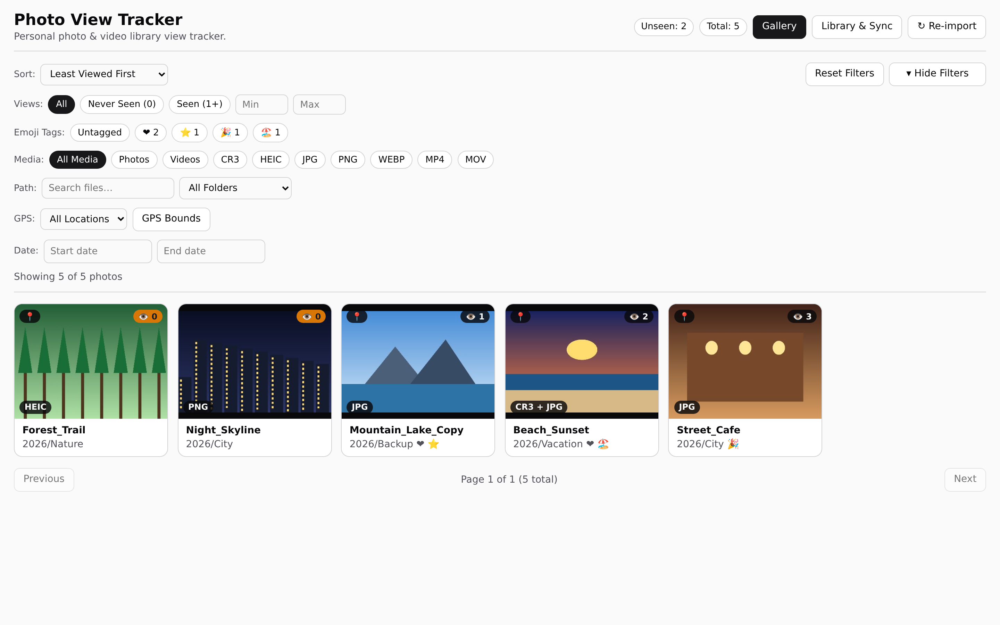
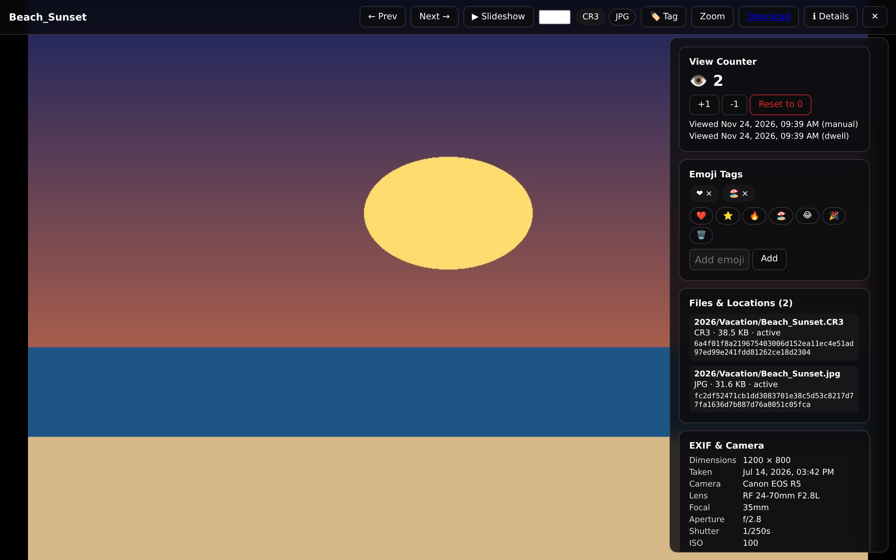
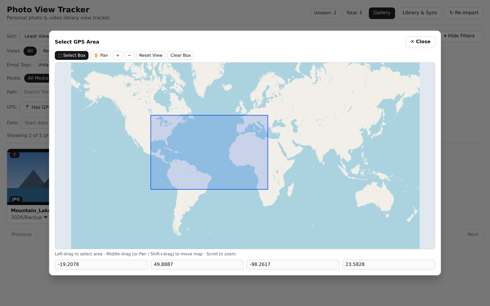
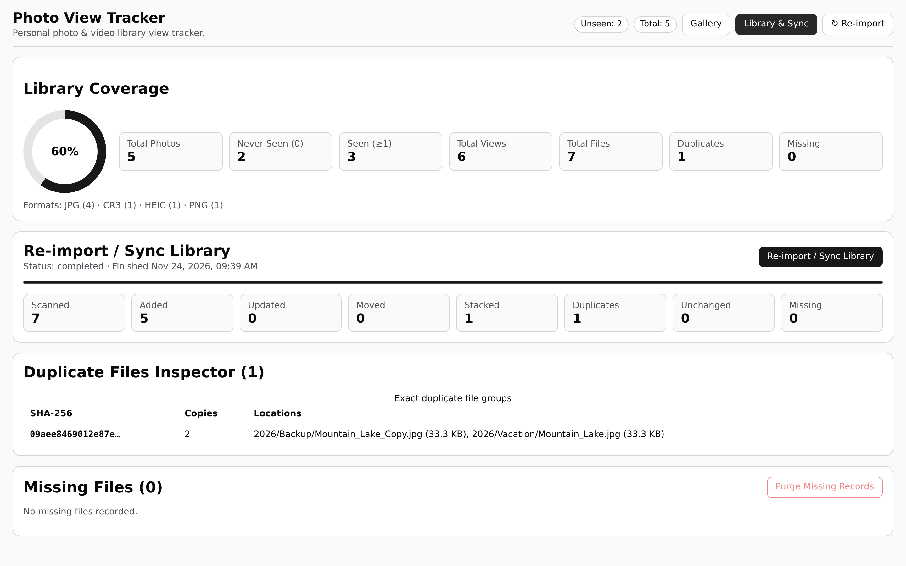
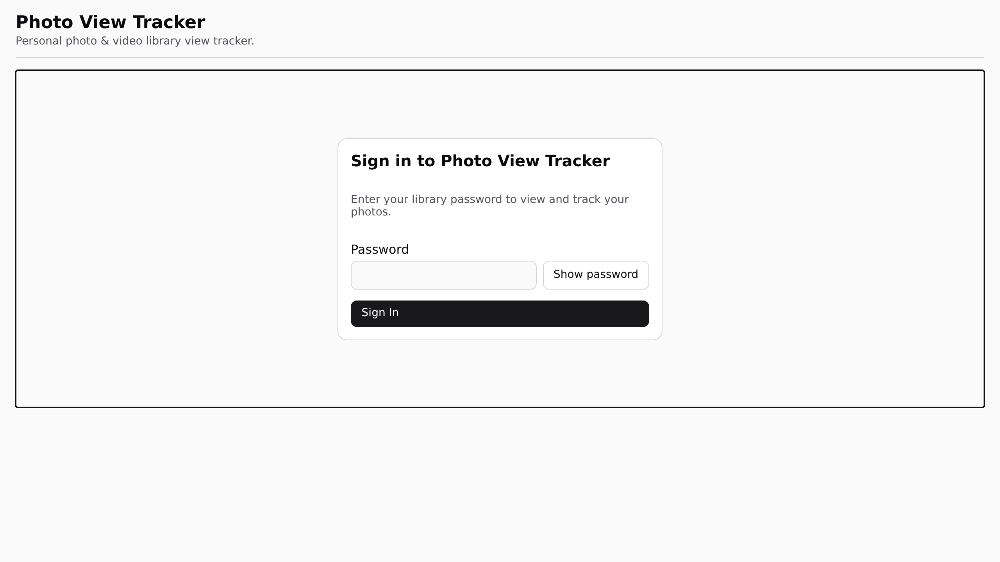

# Photo View Tracker

A single-user, self-hosted photo and video library viewer that tracks **how many times** (`view_count`) and **when** you have viewed every memory—without ever modifying your original files.

- **100% Read-Only Library (`LIBRARY_PATH`):** Never renames, edits, deletes, or writes sidecar files inside your photo folders.
- **Content-Hash Identity (`SHA-256`):** Moving or renaming photos on disk preserves all view counts, view history timestamps, and emoji tags during incremental Re-import.
- **`RAW + JPEG` Stacking & Exact Duplicates:** Automatically groups camera `CR3`/`RAW + JPG` pairs (defaulting to RAW priority with an in-lightbox toggle) and detects exact duplicates across folders.
- **Portable Single-File SQLite Storage:** Stores metadata outside your photo tree (`./data/photos.db`), auto-checkpoints WAL logs, and compiles with the Lit web UI embedded into a single binary.

---

## Interface Preview

### Gallery & Multi-Faceted Filtering
Filter by view counts (`Never Seen (0)`, `Seen (1+)`, custom min/max), emoji tags (`AND` intersection or `Untagged`), media formats (`CR3`, `HEIC`, `JPG`, `MP4`, ...), folders, capture dates, GPS presence, and seeded Random Discovery. Badges update live in-place (`👁 0` → `👁 1`) without shifting your active queue.



### Expanded Distraction-Free Lightbox & Details Drawer
Full-viewport native `<dialog>` stage with auto-hiding HUD (`2.2s` pointer idle), **1.5-second dwell timer** (active only after media load while the tab is visible), slideshow auto-advance, `CR3` | `JPG` variant switcher, zoom/fit, manual `+1` / `-1` / `Reset to 0` view controls synced with timestamped view history, emoji tagging, EXIF metadata, physical file hashes, and GPS links.



### Interactive GPS Area Map Filter
Draw a bounding box directly on the map popover (or enter exact latitude/longitude bounds) to filter geotagged photos by region, or click **Filter Nearby Photos** from any photo's Details drawer.



### Library Coverage, Incremental Sync & Duplicate Inspector
Track overall seen/unseen coverage, trigger the 4-step incremental **Re-import / Sync Library** workflow, inspect exact `SHA-256` duplicates across folders, and safely purge missing records (with automatic pre-purge SQLite backup).



### Optional Single-User Authentication
Protect remote or LAN deployments with password login (`HttpOnly`, `SameSite=Lax` signed session cookies and rate-limited login attempts), or set `AUTH_DISABLED=true` for frictionless `127.0.0.1` local usage.



---

## Core Features

See the full user guide in [docs/FEATURES.md](docs/FEATURES.md) for detailed behavior, shortcuts, and workflows:

- **1.5s Dwell View Tracking & History Sync** (plus slideshow auto-advance and manual `+1`/`-1`/`Reset`)
- **`RAW + JPEG` Stacking** (`CR3 > HEIC > JPG` priority, still-photos-only rule, split-stack preservation)
- **Exact Duplicate Tracking** (shared `view_count` and tags across folders + Duplicate Inspector)
- **Emoji Tagging** (Unicode NFC canonicalization + multi-tag `AND` & `Untagged` filtering)
- **Interactive GPS Map Bounds & EXIF Metadata**
- **4-Step Incremental Sync** (unmounted-drive guard, `(path, size, mtime)` fast-skip, move/edit reconciliation)

---

## Quickstart

### Option 1: Docker Compose (Recommended)

The container image bundles the compiled Go binary, embedded web UI, `exiftool`, `ffmpeg`, and `libheif-examples`, and mounts your photo library strictly **read-only** (`/photos:ro`).

1. Copy the template environment file and set your password (or `AUTH_DISABLED=true` for local-only use):

   ```bash
   cp .env.example .env
   ```

2. Start the server using the bundled sample library (`./examples/photos`), or pass `HOST_LIBRARY_PATH` pointing to your real photo folder:

   ```bash
   # Try right away with the bundled sample photos:
   docker compose up -d

   # Or mount your own photo library (mounted read-only inside the container):
   HOST_LIBRARY_PATH=/path/to/your/photos docker compose up -d
   ```

3. Open [http://localhost:8080](http://localhost:8080), sign in (default sample password in `.env.example` is `change-me`), go to **Library & Sync**, and click **Re-import / Sync Library**.

> **Persistent data:** By default, Docker Compose stores `/data/photos.db` and `/data/cache` in the `phototracker_data` named volume so the non-root container user (`UID 10001`) works out of the box. See the commented `HOST_DATA_PATH` bind mount in [`docker-compose.yml`](docker-compose.yml) if you prefer binding a host folder directly.

### Option 2: Native Single Binary (Build from Source)

**Prerequisites:** Go **1.26+** (pure Go, no CGO required) and Node.js **20+**.

1. Configure `.env`:

   ```bash
   cp .env.example .env
   # .env.example points LIBRARY_PATH=./examples/photos by default.
   # Optionally run `make seed-examples` to copy sample photos into ./photos/.
   ```

2. Install frontend dependencies, build the embedded UI + Go binary, and start the server:

   ```bash
   npm --prefix web install
   make build
   ./bin/phototracker
   ```

3. Open [http://localhost:8080](http://localhost:8080) and run **Re-import / Sync Library**.

For live-reloading local development (Go API + Vite dev server on `:5173` proxying `/api` to `:8080`):

```bash
make run
```

---

## Configuration Reference (`.env` & Environment Variables)

Configuration is loaded in order of precedence: **process environment variables > `.env` file > built-in defaults** (see [`.env.example`](.env.example) and [`internal/config/config.go`](internal/config/config.go)).

| Variable | Code Default | `.env.example` | Description |
| :--- | :--- | :--- | :--- |
| `LIBRARY_PATH` | `./photos` | `./examples/photos` | Root directory of your media library (always accessed 100% read-only). |
| `DB_PATH` | `./data/photos.db` | `./data/photos.db` | SQLite database path. Must live outside `LIBRARY_PATH`. |
| `CACHE_PATH` | `./data/cache` | `./data/cache` | Directory for cached `400px` thumbnails and `2560px` previews (outside `LIBRARY_PATH`). |
| `HOST` | `""` (all interfaces) | `127.0.0.1` | Bind address (`127.0.0.1` recommended for local-only use; `0.0.0.0` in Docker). |
| `PORT` | `8080` | `8080` | TCP port (`1`–`65535`) for the HTTP server. |
| `AUTH_DISABLED` | `false` | `false` | Set `true` to bypass login for frictionless loopback-only usage. |
| `AUTH_PASSWORD` | `""` | `change-me` | Plaintext password for single-user login when `AUTH_DISABLED=false`. |
| `AUTH_PASSWORD_HASH` | `""` | `""` | Optional `SHA-256` hex digest (optionally prefixed with `sha256:`); takes precedence over `AUTH_PASSWORD`. |
| `AUTH_SECRET` | `""` | `""` | Optional hex or raw HMAC-SHA256 signing key for session cookies. Auto-generated & persisted in SQLite `app_settings` if omitted. |
| `COOKIE_SECURE` | `false` | `false` | Set `true` when serving behind HTTPS so `pt_session` carries the `Secure` attribute. |
| `SYNC_WORKERS` | `runtime.NumCPU()` | `8` (commented) | Max concurrent `SHA-256` file hashing workers during sync (`> 0`). |
| `PREVIEW_WORKERS` | `min(4, max(1, NumCPU/2))` | `4` (commented) | Max concurrent media decode workers (`> 0`) to bound memory on large RAW/HEIC files. |
| `LOG_FORMAT` | `text` | `text` | Structured `slog` output format (`text` or `json`). |
| `LOG_LEVEL` | `info` | `info` | Minimum log level (`debug`, `info`, `warn`, or `error`). |

When using Docker Compose ([`docker-compose.yml`](docker-compose.yml)), `HOST_LIBRARY_PATH` (default `./examples/photos`) controls the host photo directory mounted read-only at `/photos:ro`, while `/data` persists in the `phototracker_data` volume (or an optional `HOST_DATA_PATH` bind mount writable by UID `10001`).

---

## External Media Dependencies (`exiftool`, `ffmpeg`, `libheif`)

Standard images (`JPG`, `PNG`, `GIF`), embedded-JPEG previews, and core ISOBMFF/TIFF metadata extraction work in pure Go out of the box. Installing the optional CLI tools unlocks full format support (already pre-installed in the Docker image):

| Tool | Purpose | Behavior When Absent |
| :--- | :--- | :--- |
| **`exiftool`** | Extracts embedded full-size previews (`-PreviewImage` / `-JpgFromRaw`) and rich EXIF tags from `.CR3` and other RAW files. | Falls back to `ffmpeg`, then pure-Go embedded JPEG & native TIFF/CR3 metadata parsing. |
| **`heif-convert`** (`libheif`) | Decodes `.HEIC` / `.HEIF` images while automatically applying HEIF container rotation (`irot`/`imir`). | Falls back to `ffmpeg`, then embedded JPEG scan. |
| **`ffmpeg`** | Extracts poster frames for `.MP4` / `.MOV` / `.MKV` / `.WebM` videos and acts as fallback image decoder. | Falls back to embedded JPEG scan or generated video poster thumbnail; videos still stream via HTTP Range. |

Install natively on your host:

```bash
# Debian / Ubuntu
sudo apt-get update && sudo apt-get install -y libimage-exiftool-perl libheif-examples ffmpeg

# macOS (Homebrew)
brew install exiftool libheif ffmpeg

# Arch Linux
sudo pacman -S perl-image-exiftool libheif ffmpeg
```

---

## Backing Up & Sharing the SQLite Database

Your view counts, view history timestamps, and emoji tags are stored in `DB_PATH` (`./data/photos.db`):

1. **Portable Relative Paths:** All file paths in `photo_files` are stored normalized to Unicode NFC relative to `LIBRARY_PATH`, so the same database works across Linux, macOS, and Windows machines even when your photo folder lives at different mount points.
2. **Automatic WAL Checkpointing:** SQLite runs in `WAL` mode during normal operation and automatically executes `PRAGMA wal_checkpoint(TRUNCATE)` after every completed sync and during graceful shutdown (`SIGINT` / `SIGTERM`), flushing changes into the single `.db` file.
3. **Automatic Safety Backups:** Before applying pending SQL schema migrations on startup or purging missing records (`DELETE /api/v1/library/missing`), the backend checkpoints WAL and copies `photos.db` to a timestamped `.bak.*` file in the same directory.
4. **Syncing Across Machines (Syncthing / Nextcloud / Dropbox / USB):**
   - Stop Photo View Tracker cleanly (`Ctrl+C` / `docker compose stop`) before copying or syncing `photos.db` so no active writes occur during transfer.
   - If using the default `phototracker_data` Docker volume, export a clean copy after stopping with `docker compose cp phototracker:/data/photos.db ./photos.db`.
   - Sync or back up **`photos.db`** only—you can safely exclude `cache/` (`CACHE_PATH`), as thumbnails and previews are deterministically regenerated from content hashes on demand.

---

## Development & Quality Gates

| Make Target | Description |
| :--- | :--- |
| `make build` | Build frontend bundle (`web/dist`) and compile single binary (`bin/phototracker`) |
| `make run` | Run Go API (`:8080`) and Vite HMR frontend (`:5173`) concurrently |
| `make seed-examples` | Copy sample photos from `examples/photos/` into `./photos/` |
| `make lint-max-file` | Verify every `.go`, `.ts`, and `.css` file is `<= 1,000` lines |
| `make lint` | Run `golangci-lint` (`depguard`, `ireturn`, `funlen`, `revive`, `gofumpt`), ESLint, and TypeScript checks |
| `make test-unit` | Run fast in-memory Go (`-short -race`) and Vitest unit suites |
| `make test-integration` | Run Go SQLite, media pipeline, and HTTP API integration tests (`-race`) |
| `make test-coverage` | Enforce **> 90.0%** coverage per layer in Go (`internal/...`) and frontend (`web/`) |
| `make test-e2e` | Run standalone black-box Playwright E2E suite (`e2e/`) against compiled binary |
| `make test-perf` | Run Go latency/throughput benchmarks |
| `make check` | Run all gates (`lint-max-file`, `lint`, `test-coverage`, `test-e2e`, `test-perf`) |

Further documentation:
- [docs/FEATURES.md](docs/FEATURES.md) — Detailed feature & workflow guide
- [docs/SPECIFICATION.md](docs/SPECIFICATION.md) — System architecture & database schema
- [docs/openapi.yaml](docs/openapi.yaml) — OpenAPI 3.1 REST contract
- [docs/PROJECT_PLAN.md](docs/PROJECT_PLAN.md) — Implementation phases & progress
- [docs/adr/](docs/adr) — Architecture Decision Records
- [AGENTS.md](AGENTS.md) — Architectural boundaries & contributor rules
