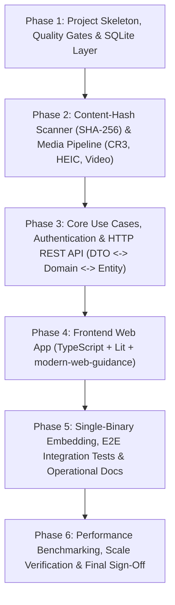

# Photo View Tracker — Implementation Project Plan

This project plan breaks down the implementation described in [docs/SPECIFICATION.md](file:///home/theo/Projects/Photos/docs/SPECIFICATION.md) into **6 sequential phases**. Every phase ends with passing unit tests, integration tests, **strictly `> 90%` test coverage (`make test-coverage`)**, linters (`depguard` + `ireturn`), and the 1,000-line `lint-max-file` check.

---

## Roadmap Overview

---

## Phase 1: Project Skeleton, Quality Gates & SQLite Foundation

**Goal:** Establish the repository structure, automated linters (including `depguard` for the 3-struct separation and `lint-max-file` at 1,000 lines), pure-Go SQLite connection with WAL auto-checkpointing, and repository implementations.

### Tasks
- [x] **1.1 Repository, Tooling & Agent Rulebook Setup:**
  - Initialize Go module (`go.mod`) and frontend workspace (`web/package.json` with Vite, TypeScript, Lit, Vitest, ESLint).
  - Install `GoogleChrome/modern-web-guidance` skills into the workspace for frontend implementation guidance.
  - Create root `AGENTS.md` (AI & contributor rulebook), `.gitmessage` (Conventional Commits template), `.github/pull_request_template.md` (PR quality gate checklist), and initial Architecture Decision Records (`docs/adr/0001..0004`).
  - Create `.golangci.yml` with `depguard` (enforcing strict separation between `internal/domain`, `internal/usecase`, `internal/adapter/httpapi`, `internal/adapter/sqlite`, and `internal/adapter/media`), `ireturn` (`allow: [anon, error, empty, stdlib, generic]`, enforcing **"Accept interfaces, return structs"**), `funlen` (max 60 lines in production code, excluding `*_test.go`), and `revive` (`exported` + `package-comments` enforcing GoDoc comments on all packages and exported symbols).
  - Create root `Makefile` with targets: `build`, `run`, `test-unit`, `test-integration`, `test-coverage` (enforcing **> 90.0%** statement/line coverage per layer across Go and Frontend), `test-perf` (running Go benchmarks and performance latency assertions), `lint`, `lint-max-file` (enforcing ≤ 1,000 lines per file), and `check` (running all gates).
- [x] **1.2 Pure Domain Models (`internal/domain`):**
  - Define pure Go structs (`Photo`, `PhotoFile`, `ScannedFile`, `DuplicateGroup`, `EXIFMetadata`, `ViewEvent`, `EmojiTagCount`, `PhotoFilter`, `SyncReport`, `LibraryStats`) with **zero** JSON or DB struct tags and **zero** interfaces (interfaces live at their consumers in `usecase` and `adapter/httpapi`).
  - Write table-driven unit tests (`internal/domain/*_test.go`) achieving `> 90%` coverage on domain validation (including NFC-normalized emoji tag validation, still-photo-only `stack_key` computation, and media format priority `CR3 > HEIC > JPG`).
- [x] **1.3 SQLite Entities, Migrations & Repositories (`internal/adapter/sqlite`):**
  - Configure `modernc.org/sqlite` connection pool with DSN pragmas (`_pragma=journal_mode(WAL)&_pragma=synchronous(NORMAL)&_pragma=foreign_keys(1)&_pragma=busy_timeout(10000)`) and automatic `wal_checkpoint(TRUNCATE)` helper for safe database sharing/syncing.
  - Implement versioned migration runner (`schema_migrations`) that **automatically creates a backup copy (`photos.db.bak.v<version>_<timestamp>`)** before applying any pending SQL migrations.
  - Write embedded SQL migrations (`001_initial_schema.sql`) creating `photos`, `photo_files`, `photo_views`, `photo_tags`, and `sync_runs`.
  - Create DB entity structs (`photoEntity`, `photoFileEntity`, `photoViewEntity`, `photoTagEntity`, `syncRunEntity`) and explicit `mapper.go` conversions (`toDomain` / `toEntity`) with unit tests (`mapper_test.go`).
  - Implement concrete repository structs (`*PhotoRepository`, `*ViewRepository`, `*SyncRepository`) returned directly by `New...` constructors, including `RAW + JPEG` stack grouping (`CR3` default priority), exact duplicate queries (`GET /library/duplicates`), GPS filter queries (`has_gps`, bounding box), emoji tag add/remove/list, and `emoji_tags` (`AND` + `untagged`) filter queries, plus integration tests (`*_integration_test.go`) using `t.TempDir()`.

### Phase 1 Deliverable & Verification
- `make lint` and `make lint-max-file` pass.
- `make test-unit` and `make test-integration` pass (covering `internal/domain` and `internal/adapter/sqlite`).
- `make test-coverage` passes with **> 90.0%** coverage across all Phase 1 packages.

---

## Phase 2: Content-Hash Scanner (`SHA-256`) & Media Pipeline (`CR3`, `HEIC`, Video)

**Goal:** Build the filesystem scanner, incremental `SHA-256` content tracker, EXIF metadata parser, and cached thumbnail/preview generator for standard images, RAW (`.CR3`), `.HEIC`, and videos.

### Tasks
- [x] **2.1 Incremental Filesystem Walker, `os.Root` Containment & `SHA-256` Hasher (`internal/adapter/media`):**
  - Confine all disk access in `LIBRARY_PATH` and `CACHE_PATH` (defaulting to `./data/cache` outside `LIBRARY_PATH`) using Go's `os.Root` API to prevent symlink escapes or path traversal.
  - Walk `LIBRARY_PATH` (ignoring hidden `.*` directories, `@eaDir`, AppleDouble `._*` files, and `0`-byte files) and compute NFC-normalized paths relative to `LIBRARY_PATH`.
  - Implement fast-path check: compare `(relative_path, file_size, mod_time_unix_ns)` to skip unchanged files without re-hashing.
  - Stream-hash new or modified files with `SHA-256` using a **bounded worker pool** (`SYNC_WORKERS`, defaulting to `runtime.NumCPU()`) via `errgroup.WithContext`.
- [x] **2.2 Deterministic 4-Step Library Sync Use Case (`internal/usecase/sync_library.go`):**
  - Define narrow consumer interfaces (`SyncPhotoStore`, `MediaScanner`, `PreviewExtractor`) inside `internal/usecase`, accept them in `NewSyncLibraryUseCase(...)`, and return the concrete `*SyncLibraryUseCase` struct.
  - Abort sync immediately if `LIBRARY_PATH` is unreadable or empty (`0` media files when the DB has active records) to protect against unmounted drives.
  - Reconcile in-place edits (same `relative_path`, new `SHA-256` -> update hash & preview in place while keeping `view_count`), moved/renamed files (two-step `relative_path` update), exact duplicates (attach second `photo_files` row to existing `Photo`), and reactivated `missing` files.
  - Group **`RAW + JPEG` still-photo pairs** (`media_type == 'photo'`, matching folder + lowercase base filename, never merging video with photo) under a single logical `Photo` (`stack_key`) with `CR3` as the default priority variant.
  - Mark remaining unseen `photo_files` rows as `status = 'missing'` and provide a `PurgeMissing` use case that backs up the DB first.
- [x] **2.3 Preview, Thumbnail & Format-Aware EXIF Pipeline (`internal/adapter/media`):**
  - Invoke external media tools (`exiftool`, `ffmpeg`, `libheif`) strictly via `exec.CommandContext` (never via `sh -c`) with a strict per-file timeout (`15s`) and atomic `.tmp` → rename cache writes.
  - Generate and cache `400px` JPEG grid thumbnails (`<CACHE_PATH>/<sha256>_thumb.jpg`) and `2560px` high-res web previews (`<CACHE_PATH>/<sha256>_preview.jpg`), applying EXIF `Orientation (1..8)` rotation for `.CR3`/RAW and `.JPG` while relying on `libheif` container rotation for `.HEIC` (preventing double-rotation).
  - Extract video poster frames and duration for `.MP4`, `.MOV`, `.MKV`, `.WebM`.
  - Parse EXIF metadata (Capture Date, Orientation `1..8`, **GPS Latitude/Longitude** in decimal degrees, Camera Make/Model, Lens, ISO, Aperture, Shutter Speed, Focal Length).

### Phase 2 Deliverable & Verification
- Table-driven unit tests (`internal/usecase/sync_library_test.go`) using in-memory consumer-interface fakes verifying new file import, unchanged fast-skip, moved file `view_count` preservation, missing file marking, and missing purge.
- Integration tests (`internal/adapter/media/*_integration_test.go`) in `t.TempDir()` with sample fixtures (`.jpg`, `.cr3`, `.heic`, `.mp4`) verifying `SHA-256` hashing, EXIF extraction, and thumbnail/preview file generation.
- `make check` (`lint-max-file` + `lint` + `test-coverage`) passes with **> 90.0%** coverage across `internal/domain`, `internal/usecase`, `internal/adapter/sqlite`, and `internal/adapter/media`.

---

## Phase 3: Backend Use Cases, Auth & HTTP REST API

**Goal:** Implement the remaining business use cases (search, view tracking, single-user auth) and expose the REST API with strict HTTP Request/Response DTO structs.

### Tasks
- [ ] **3.1 View Tracking, Emoji Tagging & Search Use Cases (`internal/usecase`):**
  - Define consumer interfaces (`ViewStore`, `TagStore`, `PhotoSearchStore`) in `internal/usecase` and return concrete use case structs (`*TrackViewUseCase`, `*TagPhotoUseCase`, `*SearchPhotosUseCase`).
  - Implement idempotent `RecordView` (records a timestamped view event in `photo_views` with optional `view_id` and increments `view_count`).
  - Implement `AdjustViewCount` synchronized with `photo_views` (`increment` appends a `manual` timestamp; `decrement` deletes the latest timestamp and rolls back `last_viewed_unix_ns`; `reset` clears `photo_views` for that photo and sets `view_count = 0`).
  - Implement `AddEmojiTag`, `RemoveEmojiTag`, and `ListEmojiTags` (with photo counts).
  - Implement `SearchPhotos` (including `emoji_tags` AND filter, `untagged` filter, and seeded random sort), `GetLibraryStats`, and `ListDuplicates`.
- [ ] **3.2 Single-User Authentication & Security Hardening (`internal/usecase/auth.go` & `internal/adapter/httpapi/handler_auth.go`):**
  - Implement password verification (via `PasswordVerifier` consumer interface), signed `HttpOnly` (`SameSite=Lax`) session cookies, `http.CrossOriginProtection` on mutating requests (even when `AUTH_DISABLED=true`), and an in-memory **login rate limiter** (`429 Too Many Requests`).
  - Support `AUTH_DISABLED=true` config flag for frictionless localhost usage.
- [ ] **3.3 HTTP DTOs, Mappers, OpenAPI Contract, Observability & Graceful Shutdown (`internal/adapter/httpapi` & `cmd/phototracker`):**
  - Define consumer interfaces for the use cases inside `internal/adapter/httpapi` and return concrete handler structs (`*PhotoHandler`, `*SyncHandler`, `*AuthHandler`).
  - Define HTTP Request and Response DTO structs (`dto_photo.go`, `dto_sync.go`, `dto_auth.go`) with validation and document the full REST contract in `docs/openapi.yaml` (OpenAPI 3.1).
  - Write explicit `mapper.go` functions converting HTTP DTOs ↔ Domain Objects, plus a deterministic **Domain Error → HTTP Problem JSON mapper** (`{"code", "message", "request_id"}`).
  - Add structured logging (`log/slog`) with `X-Request-ID` middleware and `GET /api/v1/health` readiness endpoint.
  - Implement endpoints for `/api/v1/auth/*`, `/api/v1/photos/*` (including `POST`/`DELETE /api/v1/photos/{id}/tags`), `/api/v1/tags`, and `/api/v1/library/*` (including `GET /api/v1/library/duplicates` and `GET /api/v1/library/missing`).
  - Implement `/api/v1/photos/{id}/preview` and `/api/v1/photos/{id}/original` defaulting to `CR3 > HEIC > JPG` priority in stacks, supporting `?format=cr3|jpg` variant selection, and using `http.ServeContent` (enabling HTTP Range requests for video scrubbing).
  - Implement **Graceful Shutdown (`SIGINT` / `SIGTERM`)** in `cmd/phototracker/main.go` that drains HTTP requests, cancels active sync workers cleanly, and runs `PRAGMA wal_checkpoint(TRUNCATE)` before exit.

### Phase 3 Deliverable & Verification
- Table-driven unit tests for `TrackView`, `AdjustViewCount`, `SearchPhotos`, `Auth` use cases, and `httpapi/mapper_test.go` DTO conversions.
- HTTP integration tests (`internal/adapter/httpapi/*_integration_test.go` with `httptest.Server`) verifying end-to-end request DTO validation (`400`), auth cookie & bypass (`401`/`200`), view counting & history sync (`POST`/`PATCH`), search filters, and `206 Partial Content` HTTP Range media streaming.
- `make check` passes with **> 90.0%** coverage across every Go package (`domain`, `usecase`, `adapter/httpapi`, `adapter/sqlite`, `adapter/media`).

---

## Phase 4: Frontend Web Application (`modern-web-guidance` + TS/Lit)

**Goal:** Build the 4 frontend views in `web/` using TypeScript, Vite, Lit Web Components, and native web platform features (`<dialog>`, View Transitions API, Popover API, responsive CSS Grid) guided by `GoogleChrome/modern-web-guidance`.

### Tasks
- [ ] **4.1 App Shell, Router & API Client (`web/src/`):**
  - Typed REST client matching the backend DTO contracts.
  - Navigation header displaying quick library stats (e.g., Unseen count) and quick **"Re-import"** indicator.
  - **Login View (`/login`)** with semantic form and session check.
- [ ] **4.2 Gallery & Search View (`/`) (`web/src/views/gallery-view.ts`):**
  - **Filter Bar:**
    - View count quick chips (`All`, `Never Seen (0)`, `Seen Once (1)`, `Rarely Seen (1–2)`, `3+`) + custom `Min` / `Max` inputs.
    - **Emoji Tag Filter Bar:** Interactive emoji chips with photo counts (e.g., `❤️ 12`, `🏖️ 5`) using `AND` semantics, plus an `Untagged` chip.
    - Media type toggle (`All`, `Photos`, `Videos`) and format filter pills (`CR3`, `HEIC`, `JPG`, `MP4`, etc.).
    - Folder filter, **GPS Location (`📍 Has GPS` + bounding box)** filter, date range filter, filename search, and Sort dropdown (`Least Viewed`, `Most Viewed`, `Date Taken`, `Last Viewed`, `Random Discovery` with deterministic session `seed`).
  - **Thumbnail Grid & Stable Browsing Session:**
    - Responsive CSS Grid with lazy-loaded thumbnails, `👁 <view_count>` badge (updating in-place when viewed without removing the card from the active browsing queue), attached emoji tag badges (`❤️ 🏖️`), `📍` GPS badge, and format/stack badge (`CR3 + JPG`, `HEIC`, `MP4 01:15`).
- [ ] **4.3 Expanded Lightbox & Details Overlay (`/photo/:id`) (`web/src/components/photo-lightbox.ts`):**
  - Native `<dialog>` modal with **View Transitions API** animation from the clicked thumbnail.
  - **1.5-Second Dwell Timer:** Starts after media load (`load`/`loadeddata`) while `document.visibilityState === 'visible'`; automatically records an idempotent view (`POST /api/v1/photos/{id}/views`) when open for ≥ 1.5s, updating the count badge live.
  - Keyboard shortcuts (`←` Prev, `→` Next, `Space` Play/Pause, `i` Details Drawer, `Esc` Close).
  - **Slideshow Mode:** Auto-advances through the current filtered result set at a configurable interval (e.g., 4s), counting views along the way.
  - **`RAW + JPEG` Variant Switcher:** Pill toggle (`CR3` | `JPG`, defaulting to `CR3`) in the lightbox toolbar when viewing a stacked camera pair (toggling variants does not count an extra view).
  - **Emoji Tagging Controls:** Quick-emoji bar in the lightbox + Emoji Tags card in the Details Drawer to add/remove emoji tags (`❤️`, `⭐`, `🔥`, `🏖️`, `😂`, `🎉`, or custom emoji picker).
  - **Details Drawer:** Displays `view_count` with manual `+1`, `-1`, and `Reset` buttons, scrollable view history timestamps, active emoji tags, all physical file locations/variants (`Files & Locations` card), **GPS Location & Map link (`Filter Nearby Photos` + OpenStreetMap/Google Maps link)**, EXIF camera metadata, and `SHA-256` hashes.
- [ ] **4.4 Library Sync & Stats View (`/library`) (`web/src/views/library-view.ts`):**
  - **"Re-import / Sync Library" Button** with live progress polling (`Scanned`, `Added`, `Moved/Relinked`, `Stacked`, `Duplicates`, `Unchanged`, `Missing`).
  - Library seen/unseen coverage visualization and breakdown by format.
  - **Duplicate Files Inspector** listing exact `SHA-256` duplicates across folders, plus **Missing Files** table with **"Purge Missing Records"** button.

### Phase 4 Deliverable & Verification
- Frontend unit & component tests (`Vitest` + `@vitest/coverage-v8`) covering API client, filter state serialization, 1.5s dwell timer state machine (`< 1.5s` cancel vs `>= 1.5s` trigger), keyboard navigation, and all 4 views.
- `eslint` (including `max-lines: 1000`), `tsc --noEmit`, and `vitest run --coverage` pass with **> 90.0%** statement, line, function, and branch coverage.

---

## Phase 5: Single-Binary Packaging, Standalone Playwright E2E Suite & Documentation

**Goal:** Embed the compiled frontend assets into the Go binary (`//go:embed`), build the standalone black-box Playwright E2E test program (`e2e/`), and document configuration and usage.

### Tasks
- [ ] **5.1 Single-Binary Static Embedding & Containerization (`Dockerfile` & `docker-compose.yml`):**
  - Embed `web/dist` into the Go HTTP router with SPA fallback and cache headers.
  - Create multi-stage `Dockerfile` (bundling the compiled Go binary with `exiftool`, `ffmpeg`, and `libheif-examples`, non-root user, and `/api/v1/health` `HEALTHCHECK`) and `docker-compose.yml` mounting `/photos:ro` (read-only) and `/data`.
- [ ] **5.2 Standalone Black-Box Playwright E2E Program (`e2e/` — `make test-e2e`):**
  - Create an isolated `e2e/` test harness that compiles and starts the full Go binary + embedded frontend against a temporary `LIBRARY_PATH`, `DB_PATH`, and `CACHE_PATH`.
  - Implement the 5 core Playwright browser journeys:
    1. **Auth Flow:** Login screen redirect, password login, `HttpOnly` cookie persistence across reload, and logout.
    2. **Sync, `RAW + JPEG` Stacking, Duplicates & Search Filters:** Trigger initial Re-import in `/library`, verify `IMG_0042.CR3` + `IMG_0042.JPG` stack into one card (`JPG + CR3`), verify duplicate files appear in the `/library` Duplicates list, and filter gallery by `Never Seen (0)`.
    3. **1.5s Dwell Counter, Emoji Tagging & Manual Controls:** Verify fast skip (`< 1.5s`, stays `0`) vs. dwell (`>= 1.5s`, increments to `1` and persists on `F5`), manual `+1` / `-1` / `Reset` buttons, and adding an emoji tag (`❤️`) in the lightbox then filtering the gallery by `❤️`.
    4. **Slideshow Mode:** Start slideshow in `<dialog>` lightbox and verify auto-advance increments view counts.
    5. **Disk Rename + Re-import:** Rename/move a viewed photo file on disk during the test, click **"Re-import"** in `/library`, and verify `view_count` is preserved under the new filename.
- [ ] **5.3 User, Feature & Operational Documentation (`README.md` & `docs/FEATURES.md`):**
  - Write `README.md` covering quickstart (native & Docker Compose), `.env` / CLI flags (`LIBRARY_PATH`, `DB_PATH`, `CACHE_PATH`, `PORT`, `AUTH_DISABLED`, `AUTH_PASSWORD`, `SYNC_WORKERS`), external media dependencies (`exiftool`, `ffmpeg`, `libheif`), and backup/sharing instructions for the SQLite database.
  - Write `docs/FEATURES.md` documenting how View Counting (1.5s dwell + manual controls), `RAW + JPEG` Stacking, Exact Duplicate Tracking, Emoji Tagging, GPS Filtering, and Incremental Re-import work.

### Phase 5 Deliverable & Verification
- `make check` runs all linters (`depguard`, `ireturn`, `eslint`, `lint-max-file` ≤ 1,000 lines), unit tests, integration tests, **> 90.0%** test coverage validation (`make test-coverage`), and the standalone black-box Playwright E2E suite (`make test-e2e`).

---

## Phase 6: Performance Benchmarking, Scale Verification & Final Sign-Off

**Goal:** Verify that the complete application meets latency, memory, and throughput budgets on large personal photo libraries (10,000+ photos/videos) and sign off on all quality gates.

### Tasks
- [ ] **6.1 SQLite & Incremental Sync Scale Benchmarks (`internal/adapter/sqlite/*_bench_test.go`, `internal/usecase/*_bench_test.go`, `internal/adapter/media/*_bench_test.go`):**
  - Seed a 10,000-photo SQLite database in `t.TempDir()` (with `photo_files`, `photo_views`, and `photo_tags`) and benchmark paginated `SearchPhotos` queries across filter combinations (`min_views`/`max_views`, `emoji_tags` `AND`, `untagged`, `formats`, `folder`, `has_gps`/bounding box, `sort_by=random_seeded`) plus concurrent `TrackView` WAL writes (`p95 < 25ms`).
  - Inspect `EXPLAIN QUERY PLAN` to confirm composite indexes (`idx_photos_status_views`, `idx_photo_tags_emoji`, `idx_photos_gps`) are used.
  - Benchmark `SyncLibraryUseCase` fast-skip incremental scan over 10,000 unchanged files (`< 500ms` metadata diff, 0 bytes re-hashed) and streaming `SHA-256` hashing with bounded `SYNC_WORKERS` / `PREVIEW_WORKERS`.
- [ ] **6.2 HTTP API & Cached Media Load Benchmarks (`internal/adapter/httpapi/*_bench_test.go`):**
  - Benchmark `GET /api/v1/photos` JSON serialization and `GET /api/v1/photos/{id}/thumbnail` / `preview` serving (`ETag`, `Cache-Control: immutable`, `206 Partial Content` byte-range streaming) under concurrent HTTP requests.
- [ ] **6.3 Frontend & E2E Scale Performance (`e2e/` Playwright Performance Spec):**
  - Boot the compiled single Go binary against a seeded 1,000+ photo dataset and measure Gallery Grid initial render, filter transitions, smooth scroll (`content-visibility: auto` + `loading="lazy"`), and `<dialog>` Lightbox open/navigation latency (`p95 < 100ms` UI transition).
- [ ] **6.4 Profiling, Bottleneck Tuning & Final Release Sign-Off:**
  - Profile any failing latency/memory budgets with `pprof` / Playwright traces and tune queries, worker pool bounds, or rendering paths as needed.
  - Wire `make test-perf` into CI and `make check`.

### Phase 6 Deliverable & Verification
- `make test-perf` passes all Go benchmark assertions (`p95 < 25ms` SQLite search on 10,000+ photos, `< 500ms` fast-skip scan) and Playwright UI scale budgets.
- Full `make check` (`lint-max-file`, `lint`, `test-coverage > 90%`, `test-e2e`, `test-perf`) passes green as the final project sign-off.
