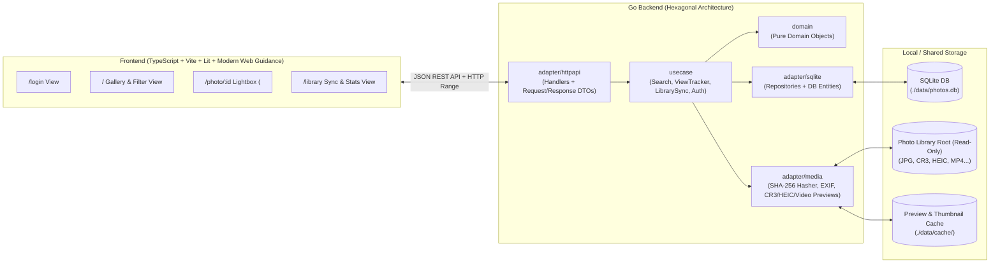

# Photo View Tracker — Architecture & Project Specification

## 1. Overview & Problem Statement

Managing a large local library of photos and videos makes it difficult to know which memories you have already revisited and which ones have gone unseen for years. Cloud services like Google Photos do not track or filter by how many times you have actually viewed each item.

**Photo View Tracker** is a single-user, local/self-hosted web application that:
1. Indexes a local directory of photos and videos (including standard formats like `JPG`/`PNG`/`WebP`, RAW formats like Canon `.CR3`, `.HEIC`/`.HEIF`, and videos like `MP4`/`MOV`/`MKV`).
2. Tracks **how many times** (`view_count`) and **when** (`last_viewed_at`, plus a full timestamp history) each photo or video has been viewed.
3. Provides fast search and filtering by **view count** (e.g., *"Never Seen (0)"*, *"Seen 1–2 times"*, custom `min`/`max` ranges), format, folder, and capture date.
4. Preserves view counts even when files are moved or renamed on disk by identifying media via **content hashing (`SHA-256`)** with a fast incremental **Re-import / Sync** workflow.
5. Stores all metadata and view counts in a portable **SQLite** database using paths relative to the library root so the database is easy to back up or share across machines.

### 1.1 Explicit Non-Goals & Architectural Boundaries

To keep the codebase lean, maintainable, and safe, the following are **explicitly out of scope**:
- **`LIBRARY_PATH` is 100% Read-Only:** The application never modifies, renames, deletes, or writes `.xmp`/`.json` sidecar files into your photo library folders.
- **No Separate Favorite (`★`) or Archive/Hide (`🚫`) Columns:** Users organize, favorite, or flag photos using flexible **Emoji Tags** (`❤️`, `⭐`, `🗑️`, `🏖️`) rather than hardcoded boolean columns.
- **No Multi-User Accounts or Browser File Uploads:** Strictly a single-user local/self-hosted viewer over local disk directories.
- **No Perceptual Hashing (`pHash`):** Photo identity relies deterministically on `SHA-256` content hashing + path continuity on in-place edits.

---

## 2. High-Level Architecture



---

## 3. Backend Structure & Strict 3-Struct Separation (Go)

The backend is written in Go and follows **Hexagonal / Clean Architecture**. A core rule of this project is the **strict separation of data structures across layers**:

| Layer | Package | Struct Type | Allowed Tags & Dependencies | Responsibility |
| :--- | :--- | :--- | :--- | :--- |
| **Transport (HTTP)** | `internal/adapter/httpapi` | **Request / Response DTOs** | `json:"..."` tags only. Imports `domain`. Defines consumer interfaces for `usecase`. | Parse & validate HTTP inputs; format HTTP JSON responses. |
| **Domain** | `internal/domain` | **Domain Objects** | **Zero struct tags** (`no json`, `no db`). Imports Go stdlib only. | Pure business entities, value objects, filter criteria, scan metadata types, and sentinel errors. |
| **Application** | `internal/usecase` | **Use Case Services** | Imports `domain`, stdlib, and `golang.org/x/sync/errgroup`. Defines consumer interfaces for repositories/adapters. | Orchestrates business rules (1.5s view recording, incremental sync reconciliation, search). |
| **Persistence (SQLite)** | `internal/adapter/sqlite` | **Entity Structs** | `db:"..."` / SQL scan targets only. Imports `domain` and `modernc.org/sqlite`. | Represent exact SQLite table rows and map to/from `domain` objects. |
| **Media & Filesystem** | `internal/adapter/media` | **Adapter Structs** | Imports `domain`, stdlib, and `golang.org/x/sync/errgroup`. | File walking, `SHA-256` hashing, EXIF parsing, `CR3`/`HEIC`/video thumbnail & preview generation. |

### 3.1 Directory Layout

```text
/
├── cmd/
│   └── phototracker/
│       └── main.go                     # Entrypoint, config loading, concrete dependency wiring
├── internal/
│   ├── config/                         # Env/file configuration loader
│   ├── domain/                         # PURE DOMAIN LAYER (stdlib only, no interfaces)
│   │   ├── photo.go                    # Photo, PhotoFile, MediaType, MediaFormat, EXIFMetadata structs
│   │   ├── view.go                     # ViewEvent, ViewAction, ViewStats domain structs
│   │   ├── filter.go                   # PhotoFilter, SortField, SortOrder, PaginatedPhotos structs
│   │   ├── sync.go                     # ScannedFile, SyncStatus, SyncReport, DuplicateGroup structs
│   │   └── errors.go                   # Domain-level sentinel errors
│   ├── usecase/                        # APPLICATION LAYER (imports internal/domain only)
│   │   ├── search_photos.go            # Defines PhotoSearchStore interface; returns *SearchPhotosUseCase
│   │   ├── track_view.go               # Defines ViewStore interface; returns *TrackViewUseCase
│   │   ├── tag_photo.go                # Defines TagStore interface; returns *TagPhotoUseCase
│   │   ├── sync_library.go             # Defines SyncPhotoStore/MediaScanner interfaces; returns *SyncLibraryUseCase
│   │   └── auth.go                     # Defines PasswordVerifier interface; returns *AuthUseCase
│   └── adapter/
│       ├── httpapi/                    # HTTP TRANSPORT LAYER (avoids stdlib net/http name clash)
│       │   ├── dto_photo.go            # Request & Response structs (ListPhotosRequest, PhotoResponse)
│       │   ├── dto_sync.go             # Sync status, duplicates & stats DTOs
│       │   ├── dto_auth.go             # LoginRequest, SessionResponse DTOs
│       │   ├── mapper.go               # Explicit DTO <-> Domain conversion functions
│       │   ├── problem.go              # Deterministic Domain Error -> HTTP Problem JSON mapper
│       │   ├── handler_photo.go        # Accepts usecase interfaces; returns *PhotoHandler
│       │   ├── handler_sync.go         # Accepts sync usecase interface; returns *SyncHandler
│       │   ├── handler_auth.go         # Accepts auth usecase interface; returns *AuthHandler
│       │   └── router.go               # HTTP mux, middleware & static fs.FS serving
│       ├── sqlite/                     # SQLITE PERSISTENCE LAYER (returns concrete structs)
│       │   ├── entity_photo.go         # photoEntity, photoFileEntity DB row structs
│       │   ├── entity_view.go          # photoViewEntity DB row struct
│       │   ├── entity_tag.go           # photoTagEntity DB row struct
│       │   ├── entity_sync.go          # syncRunEntity DB row struct
│       │   ├── mapper.go               # Explicit Entity <-> Domain conversion functions
│       │   ├── migrations/             # Embedded SQL migration files
│       │   ├── photo_repo.go           # NewPhotoRepository(db) *PhotoRepository
│       │   ├── view_repo.go            # NewViewRepository(db) *ViewRepository
│       │   └── sync_repo.go            # NewSyncRepository(db) *SyncRepository
│       └── media/                      # FILESYSTEM & MEDIA PIPELINE LAYER (returns concrete structs)
│           ├── scanner.go              # Directory walker & mtime/size fast-check (*Scanner)
│           ├── hasher.go               # Streaming SHA-256 content hasher (*Hasher)
│           ├── preview.go              # Thumbnail & high-res preview generator (*PreviewExtractor)
│           └── exif.go                 # EXIF metadata extractor (*EXIFExtractor)
├── web/                                # Frontend (TypeScript + Vite + Lit + modern-web-guidance)
│   └── embed.go                        # //go:embed dist package exposing embedded static fs.FS
├── e2e/                                # Standalone Black-Box Playwright E2E test suite
├── docs/                               # Architecture, Specification, and Project Plan docs
├── .golangci.yml                       # Linter config including depguard & ireturn rules
└── Makefile                            # Build, test-unit, test-integration, test-e2e, lint, lint-max-file targets
```

### 3.2 Concrete Example of the 3-Struct Rule

1. **HTTP Request/Response DTO (`internal/adapter/httpapi/dto_photo.go`)**:
   ```go
   // Used ONLY for HTTP query/body parsing and JSON serialization.
   type ListPhotosRequest struct {
       MinViews   *int     `json:"min_views"`
       MaxViews   *int     `json:"max_views"`
       ExactViews *int     `json:"exact_views"`
       EmojiTags  []string `json:"emoji_tags"` // AND filter: photo must have all specified emojis
       Untagged   bool     `json:"untagged"`   // True = filter photos with 0 emoji tags
       Formats    []string `json:"formats"`
       MediaType  string   `json:"media_type"`
       Folder     string   `json:"folder"`
       HasGPS     *bool    `json:"has_gps"`
       MinLat     *float64 `json:"min_lat"`
       MaxLat     *float64 `json:"max_lat"`
       MinLng     *float64 `json:"min_lng"`
       MaxLng     *float64 `json:"max_lng"`
       FromDate   *string  `json:"from_date"`
       ToDate     *string  `json:"to_date"`
       Query      string   `json:"q"`
       SortBy     string   `json:"sort_by"`    // views, date_taken, last_viewed, random
       SortOrder  string   `json:"sort_order"` // asc, desc
       Seed       int64    `json:"seed"`       // Deterministic seed for SortBy == "random"
       Page       int      `json:"page"`       // 1-based page index
       PageSize   int      `json:"page_size"`
   }

   type PhotoFileDTO struct {
       RelativePath string `json:"relative_path"`
       ContentHash  string `json:"content_hash"`
       Format       string `json:"format"`
       FileSize     int64  `json:"file_size"`
       Status       string `json:"status"`
   }

   type PhotoResponse struct {
       ID           string         `json:"id"`
       BaseName     string         `json:"base_name"`
       FolderPath   string         `json:"folder_path"`
       Formats      []string       `json:"formats"` // e.g. ["cr3", "jpg"] for stacked RAW+JPEG
       MediaType    string         `json:"media_type"`
       Width        int            `json:"width"`
       Height       int            `json:"height"`
       DurationSec  float64        `json:"duration_sec,omitempty"`
       TakenAt      *string        `json:"taken_at,omitempty"`
       GPSLatitude  *float64       `json:"gps_latitude,omitempty"`
       GPSLongitude *float64       `json:"gps_longitude,omitempty"`
       ViewCount    int            `json:"view_count"`
       EmojiTags    []string       `json:"emoji_tags"`
       Files        []PhotoFileDTO `json:"files"`   // All file paths (RAW/JPEG variants + duplicates)
       LastViewedAt *string        `json:"last_viewed_at,omitempty"`
       ThumbnailURL string         `json:"thumbnail_url"`
       PreviewURL   string         `json:"preview_url"`
   }
   ```
2. **Domain Object (`internal/domain/photo.go`)**:
   ```go
   // Pure business object used across usecases and ports. No JSON or DB tags.
   type PhotoFile struct {
       ID           string
       PhotoID      string
       ContentHash  string
       RelativePath string
       FileName     string
       FolderPath   string
       Format       MediaFormat
       FileSize     int64
       ModTime      time.Time
       Status       FileStatus // Active, Missing
   }

   type Photo struct {
       ID           string
       StackKey     string        // FolderPath + BaseName for RAW+JPEG stacking
       BaseName     string
       MediaType    MediaType
       Formats      []MediaFormat // e.g., [FormatJPG, FormatCR3]
       Files        []PhotoFile   // 1..N physical files (RAW+JPEG variants and/or exact duplicates)
       Width        int
       Height       int
       DurationSec  float64
       TakenAt      *time.Time
       EXIF         EXIFMetadata
       ViewCount    int
       EmojiTags    []string
       LastViewedAt *time.Time
       Status       FileStatus    // Active if >=1 file is Active; Missing if all files are Missing
   }
   ```
3. **Database Entities (`internal/adapter/sqlite/entity_photo.go`)**:
   ```go
   // Used ONLY inside internal/adapter/sqlite for SQL scanning and persistence.
   type photoEntity struct {
       ID           string        `db:"id"`
       StackKey     string        `db:"stack_key"`
       BaseName     string        `db:"base_name"`
       MediaType    string        `db:"media_type"`
       ViewCount    int           `db:"view_count"`
       LastViewedNs sql.NullInt64 `db:"last_viewed_unix_ns"`
       Status       string        `db:"status"`
   }

   type photoFileEntity struct {
       ID           string `db:"id"`
       PhotoID      string `db:"photo_id"`
       ContentHash  string `db:"content_hash"`
       RelativePath string `db:"relative_path"`
       FileName     string `db:"file_name"`
       FolderPath   string `db:"folder_path"`
       Format       string `db:"format"`
       FileSize     int64  `db:"file_size"`
       ModTimeUnix  int64  `db:"mod_time_unix"`
       Status       string `db:"status"`
   }
   ```

### 3.3 "Accept Interfaces, Return Structs" Rule

All Go packages strictly follow the **"Accept interfaces, return structs"** design rule:

1. **Consumer-Defined Interfaces:** Interfaces are defined **only in the consuming package** (never in the producer package or a shared `ports` file), containing only the methods that specific consumer requires:
   - `internal/usecase` defines narrow interfaces for persistence and media operations (e.g., `ViewStore`, `PhotoSearchStore`, `LibraryScanner`).
   - `internal/adapter/http` defines narrow interfaces for the use cases its handlers invoke (e.g., `PhotoSearcher`, `ViewTracker`).
2. **Concrete Struct Returns:** Every constructor (`New...`) and method returns a **concrete struct** (or `domain` value struct), never an interface:
   ```go
   // Producer in internal/adapter/sqlite/photo_repo.go:
   func NewPhotoRepository(db *sql.DB) *PhotoRepository

   // Consumer + Producer in internal/usecase/track_view.go:
   type ViewStore interface {
       IncrementView(ctx context.Context, photoID string, event domain.ViewEvent) (domain.Photo, error)
   }
   func NewTrackViewUseCase(store ViewStore) *TrackViewUseCase

   // Consumer in internal/adapter/http/handler_photo.go:
   type ViewTracker interface {
       RecordView(ctx context.Context, photoID string, source domain.ViewSource) (domain.Photo, error)
   }
   func NewPhotoHandler(tracker ViewTracker) *PhotoHandler
   ```
3. **Wired in `cmd/phototracker/main.go`:** Because Go interfaces are satisfied implicitly, `main.go` instantiates the concrete `*sqlite.PhotoRepository`, passes it into `usecase.NewTrackViewUseCase(...)`, and passes the concrete `*usecase.TrackViewUseCase` into `http.NewPhotoHandler(...)`.

### 3.4 Automated Architecture Enforcement (`depguard` & `ireturn`)

`golangci-lint` is configured with both `depguard` and `ireturn`:
- **`ireturn`:** Configured with `allow: [anon, error, empty, stdlib, generic]` so functions returning `(*ConcreteStruct, error)` pass linting while failing if any function or constructor returns a custom interface instead of a concrete struct.
- **`depguard`:**
  - `internal/domain` **can only** import Go standard library packages (`$gostd`).
  - `internal/usecase` **can only** import `internal/domain`, `$gostd`, and `golang.org/x/sync/errgroup`.
  - `internal/adapter/httpapi` **can only** import `internal/domain`, `$gostd`, and `golang.org/x/time/rate` (it never imports `usecase`, `sqlite`, or `media` directly because it defines its own consumer interfaces!).
  - `internal/adapter/sqlite` **can only** import `internal/domain`, `modernc.org/sqlite`, and `$gostd`.
  - `internal/adapter/media` **can only** import `internal/domain`, `$gostd`, and `golang.org/x/sync/errgroup`.

---

## 4. Core Domain Mechanics

### 4.1 Photo Identity, Exact Duplicates, `RAW + JPEG` Stacking & Deterministic 4-Step Sync

To ensure renaming folders, editing EXIF in-place, or moving files never resets your view history, while gracefully handling duplicate copies and `RAW + JPEG` camera pairs:

1. **Logical `Photo` (UUID/ULID) vs. Physical `PhotoFile` (`1 -> Many`):**
   - A logical **`Photo`** (`photos` table, identified by a generated UUID/ULID `id`) owns the `view_count`, `photo_views` history, `photo_tags` emojis, and EXIF metadata.
   - Each physical file on disk is stored in **`photo_files`** (`relative_path` normalized to Unicode NFC and relative to `LIBRARY_PATH`, `content_hash`, `format`, `file_size`, `mod_time_unix_ns`, `status`) referencing `photos.id`.
2. **Exact Duplicate Handling (`1 Photo -> Multiple File Locations`):**
   - If the exact same file (identical `SHA-256` `content_hash`) exists in multiple folders (e.g., `Backup/2024/IMG_01.JPG` and `Vacation/IMG_01.JPG`), both `photo_files` rows link to the **same logical `Photo`**.
   - Viewing the photo once increments the shared `view_count` for all copies, the scanner never errors on duplicate files, and `/library` provides a **"Duplicate Files"** report listing all `SHA-256` hashes that have `> 1` active file path on disk.
3. **`RAW + JPEG` Pair Stacking (`.CR3` + `.JPG`), Default Preview Priority & Split-Stack Rule:**
   - **Still Photos Only (`media_type == 'photo'`):** When a camera saves both a RAW file and a standard image in the same folder with the same case-insensitive base filename (e.g., `2025/Trip/IMG_0042.CR3` and `2025/Trip/IMG_0042.jpg`), both files are stacked under the **same logical `Photo`** (`stack_key = "2025/Trip/photo/img_0042"`). Videos (e.g., iPhone Live Photo `.MOV` clips) have `media_type == 'video'` and are **never** stacked with still photos.
   - **Representative File Priority (`RAW > HEIC > Standard Image`):** In a stacked `RAW + JPEG` pair, the **RAW (`.CR3`)** file takes priority as the default preview and EXIF source (`CR3 > HEIC > JPG/PNG/WebP`). In the Lightbox Detail view, a format toggle (`CR3` | `JPG`) lets you switch to inspecting or downloading the `JPG` variant (`?format=jpg`).
   - **Split-Stack Rule:** If one file of a stacked `CR3 + JPG` pair is later moved to a different folder on disk while the other remains in the original folder, the remaining file keeps the existing `Photo` record (`view_count`, `photo_views`, and `photo_tags`), and the moved file splits into a new standalone `Photo` in the destination folder initialized with a copy of the parent photo's current `view_count` and `photo_tags`.
4. **Deterministic 4-Step Incremental Sync Pipeline:**
   - **Pre-Flight Safety Check:** Before scanning, the scanner verifies `LIBRARY_PATH` is readable and non-empty. If `LIBRARY_PATH` is unreadable or contains `0` valid media files while the database already has active records (e.g., an external drive was unplugged), the sync **aborts immediately** without marking your library as missing.
   - **Step 1 — Full Directory Walk & Fast Metadata Check:**
     - Walks `LIBRARY_PATH` (automatically ignoring hidden directories starting with `.`, `@eaDir`, AppleDouble `._*` files, and `0`-byte files).
     - Compares `(relative_path, file_size, mod_time_unix_ns)` against existing rows in `photo_files`. If all three match an active row, the file is unchanged and skipped immediately without reading disk bytes. If it matches a `missing` row (e.g., a drive was reconnected), the row is reactivated (`status = 'active'`).
     - Any existing DB `relative_path` not seen on disk during Step 1 is flagged as a **missing/move candidate**.
   - **Step 2 — Parallel Content Hashing (`SHA-256`):**
     - Only new or modified paths are hashed in parallel via the bounded I/O worker pool (`SYNC_WORKERS`).
   - **Step 3 — Transactional Reconciliation:**
     - **Case A — In-Place File Edit (Same `relative_path`, New `SHA-256`):** Path continuity wins. The existing `photo_files` row updates its `content_hash`, `file_size`, and `mod_time_unix_ns` in place and regenerates its thumbnail/preview, **preserving `photo_id`, `view_count`, and `photo_tags`**.
     - **Case B — Moved or Renamed File (New `relative_path`, Known `SHA-256` Matching a Missing Candidate):** The missing candidate's `photo_files` row updates its `relative_path`, `file_name`, `folder_path`, and `status = 'active'` (using a two-step update within the transaction so rename chains like `A->B, B->C` never collide on `UNIQUE(relative_path)`). If all files of that `Photo` moved, `photos.folder_path`, `base_name`, and `stack_key` update accordingly. **All `view_count`, `photo_views`, and `photo_tags` remain 100% intact.**
     - **Case C — Exact Duplicate (New `relative_path`, Known `SHA-256` Matching an Active File):** Inserts a new `photo_files` row attached to the existing `photo_id`.
     - **Case D — New Variant Matching an Existing Still-Photo `stack_key`:** Inserts a new `photo_files` row under the matching stacked `Photo`.
     - **Case E — Brand New Photo/Video:** Creates a new `Photo` (`view_count = 0`) and `photo_files` row, extracts EXIF metadata, and generates cached thumbnails/previews.
   - **Step 4 — Mark Remaining Unseen Candidates as `missing`:**
     - Any candidate from Step 1 not relinked by a move in Step 3 is marked `status = 'missing'`. A logical `Photo` is marked `status = 'missing'` only when all of its `photo_files` rows are `missing`.
     - Executing `DELETE /api/v1/library/missing` first takes an automatic SQLite backup (`photos.db.bak.pre_purge_<timestamp>`) before deleting missing rows and any orphaned `photos`.

### 4.2 View Counting & History Synchronization Rules

1. **Automatic View Increment (Expanded Lightbox Dwell):**
   - Scrolling past thumbnails in the gallery grid **never** increments `view_count`.
   - In the **Expanded Lightbox View** (`/photo/:id`), the **1.5-second dwell timer** starts only after the media finishes loading (`` `load` or `<video>` `loadeddata`) while `document.visibilityState === 'visible'`.
   - Navigating away before 1.5s, hiding the browser tab, or toggling between `CR3` and `JPG` variants of the same stacked photo **does not** trigger a view increment.
   - Once 1.5s elapses, the frontend sends `POST /api/v1/photos/{id}/views` with a client-generated `view_id` (UUID for idempotency so network retries never double-count).
   - The backend inserts a timestamped entry in `photo_views` and atomically updates `photos.view_count = view_count + 1` and `photos.last_viewed_unix_ns`.
2. **Manual Adjustments & Strict History Synchronization (`PATCH /api/v1/photos/{id}/views`):**
   - `view_count` and `photo_views` are kept strictly synchronized so `view_count` always equals `COUNT(photo_views)`:
     - **`increment` (`+1`):** Inserts a new row in `photo_views` (`source = 'manual'`) and sets `last_viewed_unix_ns` to now.
     - **`decrement` (`-1`):** Deletes the most recent `photo_views` row for that photo, decrements `view_count` (clamped at `0`), and updates `last_viewed_unix_ns` to the new latest `photo_views.viewed_at_unix_ns` (or `NULL` if `0`).
     - **`reset` (`0`):** Deletes all `photo_views` rows for that photo, sets `view_count = 0`, and sets `last_viewed_unix_ns = NULL`.

### 4.3 Emoji Tagging & Emoji Search (`AND` Semantics)

1. **Tagging Photos with Emojis:**
   - Users can attach one or more Unicode emoji tags (e.g., `❤️`, `⭐`, `🏖️`, `🎉`, `😂`, `🗑️`) to any photo or video.
   - The domain layer normalizes each emoji (Unicode NFC + stripping trailing `U+FE0F` variation selector for canonical storage so `❤` and `❤️` never duplicate) and validates that every rune falls within allowed Unicode Emoji/Pictograph/Symbol code point ranges (rejecting plain ASCII letters/words).
   - Because emoji tags are linked to `photos.id`, moving, renaming, or editing a file in place automatically preserves all of its emoji tags.
2. **Filtering & Searching by Emoji (`AND` Intersection + `Untagged`):**
   - Selecting multiple emojis (`emoji_tags=❤️,🏖️`) uses **`AND` semantics** (returns photos that have **all** selected emojis).
   - Passing `untagged=true` returns photos that have **zero** emoji tags.
   - `GET /api/v1/tags` returns all emoji tags currently used across active photos with their counts (`[{"emoji": "❤️", "count": 42}]`).

### 4.4 Media Format Support & Preview Cache Pipeline

Supported file extensions (case-insensitive):
- **Standard Images:** `.jpg`, `.jpeg`, `.png`, `.webp`, `.avif`, `.gif`
- **RAW Images:** `.cr3` (Canon RAW), `.cr2`, `.dng`, `.nef`, `.arw`, `.orf`, `.rw2`
- **High-Efficiency Images:** `.heic`, `.heif`
- **Videos:** `.mp4`, `.mov`, `.webm`, `.mkv`, `.m4v`

**Two-Tier Cache (`CACHE_PATH`, defaults to `./data/cache` outside `LIBRARY_PATH`):**
1. **Grid Thumbnails (`<sha256>_thumb.jpg`, 400px max dimension):**
   - Generated for all image, RAW, HEIC, and video files so the gallery grid loads rapidly.
   - For stacked `RAW + JPEG` photos, the default thumbnail and preview are generated from the highest-priority file (**`RAW (.cr3)` > `.heic` > `.jpg`/`.png`/`.webp`**).
2. **Web Previews for Non-Browser Formats (`<sha256>_preview.jpg`, up to 2560px):**
   - Browsers cannot natively render `.CR3` or `.HEIC`.
   - For `.CR3` and RAW files, the media adapter extracts the embedded full-size JPEG preview via `exiftool -b -PreviewImage` (falling back to `-JpgFromRaw` / `ffmpeg`) and caches it on disk.
   - For `.HEIC`/`.HEIF`, the adapter converts a high-res JPEG preview via `heif-convert` (`libheif-examples`) or `ffmpeg`.
   - Standard browser-native images (`JPG`, `PNG`, `WebP`, `AVIF`) are served directly from disk in expanded view.
   - Videos (`MP4`, `MOV`, `WebM`, `MKV`) are served via `http.ServeContent` supporting **HTTP Range requests** for instant seeking. If a video container/codec (such as HEVC `.MOV` or `.MKV` on Linux browsers without hardware HEVC support) triggers a `<video>` playback error in the Lightbox, the UI automatically offers an on-demand `ffmpeg` H.264/AAC web preview stream (`?transcode=1`) alongside a **"Download / Open Original"** fallback button.
3. **Format-Aware EXIF Auto-Orientation (`Orientation` Tags 1–8):**
   - `.CR3`/RAW embedded previews and `.JPG` files store raw pixels unrotated with an EXIF `Orientation` tag (`1..8`); the media pipeline explicitly applies the EXIF orientation transform when generating thumbnails/previews for RAW and JPEG files and normalizes `width`/`height` to post-rotation dimensions.
   - `.HEIC`/`.HEIF` files store rotation in the HEIF container (`irot`/`imir`), which `heif-convert`/`libheif` applies automatically—so the pipeline does **not** apply a second EXIF rotation to `.HEIC` outputs, preventing double-rotation bugs.
4. **EXIF GPS Coordinates & Location Metadata:**
   - The EXIF extractor parses `GPSLatitude`, `GPSLatitudeRef`, `GPSLongitude`, and `GPSLongitudeRef` into signed decimal degrees (`gps_latitude`, `gps_longitude`).
   - Users can filter the gallery by whether a photo has GPS coordinates (`has_gps=true/false`) or by a geographic bounding box (`min_lat`, `max_lat`, `min_lng`, `max_lng`), and view coordinates + a direct map link inside the Lightbox Details drawer.

---

## 5. SQLite Database Schema & Sharing Strategy

- **Driver:** Pure-Go `modernc.org/sqlite` (zero CGO required, easy cross-compilation).
- **Portability & Per-Connection DSN Pragmas:**
  - `DB_PATH` is configurable (defaults to `./data/photos.db` outside `LIBRARY_PATH` so `LIBRARY_PATH` can remain strictly read-only).
  - Because `foreign_keys` and `busy_timeout` are per-connection settings in SQLite, they are passed directly in the `modernc.org/sqlite` DSN so every pooled connection inherits them:
    `file:<DB_PATH>?_pragma=journal_mode(WAL)&_pragma=synchronous(NORMAL)&_pragma=foreign_keys(1)&_pragma=busy_timeout(10000)`
  - Runs a full `PRAGMA wal_checkpoint(TRUNCATE)` after each sync and on graceful shutdown so all data is flushed into the single `.db` file for safe syncing via Syncthing, Nextcloud, Dropbox, or USB drives.

### 5.1 Core Tables

```sql
CREATE TABLE IF NOT EXISTS photos (
    id                  TEXT PRIMARY KEY,     -- UUID/ULID surrogate key
    stack_key           TEXT NOT NULL,        -- folder_path + '/' + media_type + '/' + lower(base_name)
    base_name           TEXT NOT NULL,        -- Filename without extension (e.g., 'IMG_0042')
    folder_path         TEXT NOT NULL,        -- Primary folder relative to LIBRARY_PATH
    media_type          TEXT NOT NULL,        -- 'photo' | 'video'
    width               INTEGER NOT NULL DEFAULT 0,
    height              INTEGER NOT NULL DEFAULT 0,
    orientation         INTEGER NOT NULL DEFAULT 1, -- EXIF Orientation (1-8)
    duration_sec        REAL NOT NULL DEFAULT 0,
    taken_at_unix       INTEGER,              -- EXIF DateTimeOriginal or file mtime fallback
    camera_make         TEXT,
    camera_model        TEXT,
    lens_model          TEXT,
    iso                 INTEGER,
    f_number            REAL,
    exposure_time       TEXT,
    focal_length_mm     REAL,
    gps_latitude        REAL,                 -- Decimal degrees (-90..90)
    gps_longitude       REAL,                 -- Decimal degrees (-180..180)
    view_count          INTEGER NOT NULL DEFAULT 0 CHECK (view_count >= 0),
    last_viewed_unix_ns INTEGER,
    status              TEXT NOT NULL DEFAULT 'active', -- 'active' | 'missing'
    created_at_unix     INTEGER NOT NULL,
    updated_at_unix     INTEGER NOT NULL
);

CREATE INDEX IF NOT EXISTS idx_photos_stack_key ON photos(stack_key);
CREATE INDEX IF NOT EXISTS idx_photos_status_views ON photos(status, view_count);
CREATE INDEX IF NOT EXISTS idx_photos_taken_at ON photos(taken_at_unix DESC);
CREATE INDEX IF NOT EXISTS idx_photos_folder ON photos(folder_path);
CREATE INDEX IF NOT EXISTS idx_photos_gps ON photos(gps_latitude, gps_longitude) WHERE gps_latitude IS NOT NULL;

CREATE TABLE IF NOT EXISTS photo_files (
    id               TEXT PRIMARY KEY,
    photo_id         TEXT NOT NULL REFERENCES photos(id) ON DELETE CASCADE,
    content_hash     TEXT NOT NULL,                  -- SHA-256 hex (non-unique to allow exact duplicates on disk)
    relative_path    TEXT NOT NULL UNIQUE,           -- NFC-normalized path relative to LIBRARY_PATH
    file_name        TEXT NOT NULL,
    folder_path      TEXT NOT NULL,
    format           TEXT NOT NULL,                  -- jpg, cr3, heic, mp4, etc.
    file_size        INTEGER NOT NULL,
    mod_time_unix_ns INTEGER NOT NULL,
    status           TEXT NOT NULL DEFAULT 'active', -- 'active' | 'missing'
    created_at_unix  INTEGER NOT NULL,
    updated_at_unix  INTEGER NOT NULL
);

CREATE INDEX IF NOT EXISTS idx_photo_files_photo_id ON photo_files(photo_id);
CREATE INDEX IF NOT EXISTS idx_photo_files_hash ON photo_files(content_hash);
CREATE INDEX IF NOT EXISTS idx_photo_files_format ON photo_files(format);

CREATE TABLE IF NOT EXISTS photo_views (
    id                INTEGER PRIMARY KEY AUTOINCREMENT,
    view_id           TEXT UNIQUE,          -- Optional client UUID for idempotent POST /views
    photo_id          TEXT NOT NULL REFERENCES photos(id) ON DELETE CASCADE,
    viewed_at_unix_ns INTEGER NOT NULL,
    source            TEXT NOT NULL DEFAULT 'dwell' -- 'dwell' | 'manual' | 'slideshow'
);

CREATE INDEX IF NOT EXISTS idx_photo_views_photo_id ON photo_views(photo_id, viewed_at_unix_ns DESC);

CREATE TABLE IF NOT EXISTS photo_tags (
    photo_id        TEXT NOT NULL REFERENCES photos(id) ON DELETE CASCADE,
    emoji           TEXT NOT NULL,
    created_at_unix INTEGER NOT NULL,
    PRIMARY KEY (photo_id, emoji)
);

CREATE INDEX IF NOT EXISTS idx_photo_tags_emoji ON photo_tags(emoji, photo_id);

CREATE TABLE IF NOT EXISTS sync_runs (
    id               TEXT PRIMARY KEY,
    started_at_unix  INTEGER NOT NULL,
    finished_at_unix INTEGER,
    status           TEXT NOT NULL, -- 'running' | 'completed' | 'failed'
    scanned_count    INTEGER NOT NULL DEFAULT 0,
    added_count      INTEGER NOT NULL DEFAULT 0,
    updated_count    INTEGER NOT NULL DEFAULT 0,
    moved_count      INTEGER NOT NULL DEFAULT 0,
    stacked_count    INTEGER NOT NULL DEFAULT 0,
    duplicate_count  INTEGER NOT NULL DEFAULT 0,
    unchanged_count  INTEGER NOT NULL DEFAULT 0,
    missing_count    INTEGER NOT NULL DEFAULT 0,
    error_message    TEXT
);

CREATE TABLE IF NOT EXISTS app_settings (
    key             TEXT PRIMARY KEY,
    value           TEXT NOT NULL,
    updated_at_unix INTEGER NOT NULL
);
```

---

## 6. Authentication Specification

Designed for a single-user local/self-hosted setup:
- **Configuration:**
  - `AUTH_DISABLED`: `true` or `false` (default `false`; convenient to set `true` when binding strictly to `127.0.0.1`).
  - `AUTH_PASSWORD_HASH` (Argon2id/bcrypt hash) or `AUTH_PASSWORD` in `.env` / config.
  - `AUTH_SECRET`: Optional HMAC signing secret for session cookies. If omitted, a cryptographic 32-byte random secret is generated on first run and persisted in `app_settings (key = 'session_secret')` so server restarts do not invalidate active browser sessions.
- **Session Flow:**
  - `POST /api/v1/auth/login` verifies the password using constant-time comparison and sets an `HttpOnly`, `SameSite=Lax` signed session cookie (`pt_session`, 30-day TTL).
  - `POST /api/v1/auth/logout` clears the session cookie.
  - `GET /api/v1/auth/session` returns `{ authenticated: true/false, auth_disabled: true/false }`.

---

## 7. REST API Specification

| Method | Path | Description |
| :--- | :--- | :--- |
| `GET` | `/api/v1/health` | Health & readiness check (verifies SQLite connection and `LIBRARY_PATH` access) |
| `GET` | `/api/v1/auth/session` | Check current auth session status |
| `POST` | `/api/v1/auth/login` | Authenticate with password |
| `POST` | `/api/v1/auth/logout` | Clear session cookie |
| `GET` | `/api/v1/photos` | Search & filter photos (`min_views`, `max_views`, `exact_views`, `emoji_tags` [AND], `untagged`, `media_type`, `formats`, `folder`, `has_gps`, `min_lat`, `max_lat`, `min_lng`, `max_lng`, `from_date`, `to_date`, `q`, `sort_by`, `sort_order`, `seed`, `page`, `page_size`) |
| `GET` | `/api/v1/photos/{id}` | Get full photo details, EXIF metadata, emoji tags, and recent view history timestamps |
| `POST` | `/api/v1/photos/{id}/views` | Record a new view event (`+1` after 1.5s dwell or slideshow; accepts optional `view_id` for idempotency) |
| `PATCH` | `/api/v1/photos/{id}/views` | Manually adjust view count (`{"action": "increment" \| "decrement" \| "reset"}`, synchronized with `photo_views`) |
| `POST` | `/api/v1/photos/{id}/tags` | Add an emoji tag (`{"emoji": "❤️"}`) to a photo |
| `DELETE` | `/api/v1/photos/{id}/tags/{emoji}` | Remove an emoji tag from a photo (URL-decoded & normalized) |
| `GET` | `/api/v1/tags` | List all emoji tags used in the library with photo counts (`[{"emoji": "❤️", "count": 42}]`) |
| `GET` | `/api/v1/photos/{id}/thumbnail` | Serve cached `400px` thumbnail (defaults to `CR3 > HEIC > JPG` priority in stacks) |
| `GET` | `/api/v1/photos/{id}/preview` | Serve high-res preview (defaults to `CR3 > HEIC > JPG`, or `?format=cr3\|jpg` for stacked variants; Range stream for video) |
| `GET` | `/api/v1/photos/{id}/original` | Download or stream raw original file (optional `?format=cr3\|jpg` or `?file_id=...`) |
| `GET` | `/api/v1/library/stats` | Aggregate counts (total, unseen `0`, seen `>=1`, by format, by folder, duplicate count, missing count) |
| `GET` | `/api/v1/library/duplicates` | List exact duplicate file groups sharing the same `SHA-256` across multiple disk paths |
| `GET` | `/api/v1/library/missing` | List records currently marked `status = 'missing'` |
| `POST` | `/api/v1/library/sync` | Trigger asynchronous incremental Re-import / Sync scan (returns `409 Conflict` if a sync is already running) |
| `GET` | `/api/v1/library/sync/status` | Poll current or latest sync progress and counters |
| `DELETE` | `/api/v1/library/missing` | Backup DB and purge records with `status = 'missing'` |

---

## 8. Frontend Specification (`GoogleChrome/modern-web-guidance`)

The frontend lives in `web/` and is built with **TypeScript + Vite + Lit (Native Web Components)**, strictly adhering to [GoogleChrome/modern-web-guidance](https://github.com/GoogleChrome/modern-web-guidance):
- Uses native HTML `<dialog>` for the expanded photo lightbox (proper focus trapping, `Esc` dismissal, backdrop styling).
- Uses the **View Transitions API** (`document.startViewTransition`) when expanding a grid thumbnail into the full-screen lightbox and transitioning between photos.
- Uses the native **Popover API** (`popover="auto"`) for filter dropdowns and CSS Anchor Positioning where applicable.
- Uses responsive CSS Grid (`grid-template-columns: repeat(auto-fill, minmax(...))`), `content-visibility: auto`, and native `loading="lazy"` / `decoding="async"` on thumbnails for high Core Web Vitals performance.

### 8.1 Pages & Views

1. **Login View (`/login`)**
   - Displayed only when `AUTH_DISABLED=false` and the user has no active session.
   - Uses semantic `<form>` with proper `autocomplete="current-password"` per `modern-web-guidance`.
2. **Gallery & Search View (`/`)**
   - **Top Filter Bar & Quick Chips:**
     - **View Count Presets:** `All`, `Never Seen (0)`, `Seen Once (1)`, `Rarely Seen (1–2)`, `Frequently Seen (3+)`, plus custom `Min Views` / `Max Views` numeric inputs.
     - **Emoji Tag Filter Bar:** Interactive emoji chips showing all emojis used in the library with their counts (e.g., `❤️ 42`, `🏖️ 18`, `⭐ 12`) plus an `Untagged` chip. Selecting multiple emojis applies `AND` filtering (photos matching all selected emojis).
     - **Format & Type Filter:** `All Media`, `Photos Only`, `Videos Only`, and multi-select format pills (`CR3`, `HEIC`, `JPG`, `MP4`, etc.).
     - **Folder, GPS & Search:** Folder dropdown, `Has GPS Location (📍)` filter toggle + coordinate bounds filter, filename search input, and capture date range.
     - **Sort Selector:** `Least Viewed First`, `Most Viewed First`, `Date Taken (Newest/Oldest)`, `Last Viewed`, `Random Discovery` (with a session `seed` so pagination never repeats items).
   - **Thumbnail Grid & Stable Browsing Session:**
     - Displays each photo/video card with a subtle top-right **View Count Badge** (`👁 0` highlighted distinctly for unseen items, `👁 3` for seen items), any attached **Emoji Tags** (`❤️ 🏖️`), GPS indicator (`📍` if geotagged), and bottom-left **Format Badge** (`CR3`, `CR3 + JPG` for stacked RAW+JPEG pairs, `HEIC`, `MP4 01:15`).
     - When a photo is viewed in the Lightbox and its `view_count` increments (`0 → 1`), the card updates its badge live in-place without disappearing from the active grid/lightbox queue until the user changes filters or refreshes.
3. **Expanded Photo & Detail Lightbox (`/photo/:id`)**
   - Opens in a full-viewport `<dialog>` overlay when clicking any thumbnail.
   - **1.5-Second Dwell Timer:** Starts after the media loads (`` `load` / `<video>` `loadeddata`) while `document.visibilityState === 'visible'`; if the user stays on the item for ≥ 1.5s, triggers `POST /api/v1/photos/{id}/views` and updates the badge smoothly in real time.
   - **Toolbar Controls:** Previous (`←`), Next (`→`), **Slideshow Play/Pause** (auto-advances every N seconds, counting views as they display), **`RAW + JPEG` Variant Switcher** (defaults to `CR3`, with a `CR3` | `JPG` pill toggle when viewing a stacked camera shot; switching variants does not trigger an extra view count), **Quick Emoji Tag Bar** (1-click toggle for favorite/recent emojis + Popover emoji picker), Zoom, Download Original, Toggle Details Drawer (`i`), Close (`Esc`).
   - **Details Side Drawer:**
     - **View Counter Card:** Large current `view_count`, manual `+1`, `-1`, and `Reset to 0` buttons, plus a scrollable list of `photo_views` timestamps (*"Viewed Nov 17, 2026 at 18:40"*).
     - **Emoji Tags Card:** Displays active emoji tags on the photo with `×` to remove, quick-add buttons (`❤️`, `⭐`, `🔥`, `🏖️`, `😂`, `🎉`), and an input/picker to add any emoji.
     - **Files & Locations Card:** Lists all physical files belonging to this photo (both `JPG` and `CR3` stack variants and any duplicate file paths on disk, with their `SHA-256` hash and individual file size).
     - **EXIF & Camera Metadata:** Camera body, lens, focal length, aperture, shutter speed, ISO, post-orientation dimensions, and capture timestamp.
     - **GPS Location & Map Card** *(when GPS EXIF is present)*: Displays decimal coordinates (`lat, lng`), a **"Filter Nearby Photos"** button, and a 1-click external map link (OpenStreetMap / Google Maps).
4. **Library Sync & Stats View (`/library`)**
   - **Coverage Dashboard:** Progress ring/bar showing % of library seen at least once vs. never seen (`view_count == 0`), plus breakdown by format (`CR3`, `HEIC`, `JPG`, `Video`).
   - **Re-import / Sync Control Card:**
     - Prominent **"Re-import / Sync Library"** button.
     - Live progress bar showing `Scanned`, `Added`, `Moved/Relinked`, `Stacked`, `Duplicates`, `Unchanged`, and `Missing` counts, plus history of recent sync runs.
   - **Duplicate Files Inspector:** Lists all exact duplicate groups (`SHA-256` with `> 1` active file path on disk) showing all folder locations so you know where redundant copies exist.
   - **Missing Files Manager:** Lists any files marked `missing` (with their last known relative path and view count) and a button to purge them if permanently deleted.

---

## 9. Testing Strategy, Coverage Validation (> 90%) & Quality Gates

Every phase and pull request must pass all quality gates automated in the root `Makefile`. **Code is only considered passing if total test coverage is strictly greater than 90% (`> 90.0%`).**

### 9.1 Unit Testing (`make test-unit`)

Unit tests run completely in memory with **zero disk, network, or database I/O** and execute in under 2 seconds.

1. **Go Backend Unit Tests (`go test -short -race ./...`):**
   - **Table-Driven Pattern:** All Go unit tests use idiomatic table-driven subtests (`t.Run(tc.name, ...)`), testing happy paths, boundary conditions (`view_count == 0` decrement clamping, empty filters), and error propagation.
   - **Consumer-Interface Fakes (Zero Reflection Mocks):** Because the codebase follows *"Accept interfaces, return structs"*, unit tests in `internal/usecase` and `internal/adapter/http` pass lightweight, type-safe in-memory fake structs implementing the consumer's narrow interface.
   - **What is Unit Tested:**
     - `internal/domain`: Validation rules, filter construction, media format classification (`.cr3` -> RAW photo, `.heic` -> HEIC photo, `.mp4` -> video).
     - `internal/usecase`:
       - `TrackViewUseCase`: Dwell view increment (`+1`), timestamp recording, manual `+1` / `-1` (clamped at `0`) / `reset`, unknown photo error handling.
       - `SyncLibraryUseCase`: Fast-skip when `(relative_path, size, mtime)` match; relinking existing `view_count` when `SHA-256` matches a moved/renamed file; inserting brand-new `SHA-256` records with `view_count = 0`; marking unseen paths as `status = 'missing'`; purging missing records.
       - `SearchPhotosUseCase`: Filter normalization (`min_views`, `max_views`, `formats`, `folder`, `sort_by`).
       - `AuthUseCase`: Password hash comparison, session token signing/verification, `AUTH_DISABLED` bypass behavior.
     - `internal/adapter/http/mapper_test.go` & `internal/adapter/sqlite/mapper_test.go`: 100% coverage of all DTO ↔ Domain and Entity ↔ Domain conversions.

2. **Frontend Unit Tests (`npm --prefix web run test:unit` via Vitest):**
   - **1.5-Second Dwell Timer State Machine:** Uses `vi.useFakeTimers()` to verify that:
     - Opening a photo for `< 1.5s` (e.g., 1,200ms) and navigating away **does not** call `POST /api/v1/photos/{id}/views`.
     - Keeping a photo open for `>= 1,500ms` calls `POST /api/v1/photos/{id}/views` **exactly once** per open event.
   - **Filter & URL State Synchronization:** Verifies view-count presets (`0`, `1`, `1-2`, `3+`), custom min/max ranges, format pills, and sort options serialize cleanly to API query parameters.
   - **Web Components (`<dialog>` Lightbox, Gallery Grid, Library Sync Card):** Tested in `happy-dom` / `@open-wc/testing` for DOM rendering, keyboard navigation (`ArrowLeft`, `ArrowRight`, `Escape`), and badge updates.

---

### 9.2 Integration Testing (`make test-integration`)

Integration tests verify real I/O boundaries using isolated temporary directories (`t.TempDir()`) so tests are 100% repeatable and leave no artifacts behind.

1. **SQLite Repository Integration Tests (`internal/adapter/sqlite/*_integration_test.go`):**
   - Spins up a real SQLite database file inside `t.TempDir()` using `modernc.org/sqlite` with DSN pragmas (`WAL`, `foreign_keys(1)`, `busy_timeout(10000)`).
   - Verifies schema migrations, automatic pre-migration DB backup, `WAL` mode activation, and `PRAGMA wal_checkpoint(TRUNCATE)` portability.
   - Verifies `UNIQUE(relative_path)` enforcement, multi-path exact duplicate attachment (`content_hash`), `RAW + JPEG` stack grouping (`CR3` default priority), atomic `view_count` increments under concurrent goroutines (`-race`), `photo_views` synchronization on `increment`/`decrement`/`reset`, and complex SQL filtering (`min_views`, `max_views`, `emoji_tags` AND, `untagged`, `formats`, `folder`, `has_gps`/bounding-box, and seeded random sort).
2. **Filesystem & Media Pipeline Integration Tests (`internal/adapter/media/*_integration_test.go`):**
   - Uses real fixture files in `testdata/` (sample `.jpg` with EXIF Orientation `6` and GPS tags, sample `.cr3`, sample `.heic`, sample `.mp4`).
   - Verifies streaming `SHA-256` hashing, EXIF metadata extraction, `400px` thumbnail creation in `CACHE_PATH`, and `.CR3`/`.HEIC` high-res preview generation (confirming `.HEIC` is not double-rotated).
   - Simulates a real disk workflow in `t.TempDir()`:
     1. Initial scan of 5 files → all imported with `view_count = 0`.
     2. Increment `view_count` of `IMG_001.CR3` to `4`.
     3. Edit `IMG_003.JPG` in place (changing its `SHA-256` at the same `relative_path`), rename/move `IMG_001.CR3` to `subfolder/RENAMED.CR3`, and delete `IMG_002.JPG`.
     4. Run incremental Re-import → `IMG_003.JPG` updates its hash in place while preserving its `Photo` ID, `subfolder/RENAMED.CR3` keeps `view_count = 4` (0 bytes re-hashed for untouched files), and `IMG_002.JPG` transitions to `status = 'missing'`.
3. **HTTP End-to-End API Integration Tests (`internal/adapter/httpapi/*_integration_test.go`):**
   - Boots a real `httptest.Server` wired with concrete `httpapi` handlers → concrete `usecase` services → concrete `sqlite` repositories → real temp filesystem.
   - Tests the full HTTP lifecycle:
     - Unauthenticated requests rejected with `401 Unauthorized` when auth is enabled; accepted after `POST /api/v1/auth/login` sets the `HttpOnly` cookie.
     - Invalid DTO payloads rejected with `400 Bad Request`.
     - Full round-trip of `POST /api/v1/library/sync`, `GET /api/v1/photos?min_views=0&max_views=0`, idempotent `POST /api/v1/photos/{id}/views`, `PATCH /api/v1/photos/{id}/views`, `POST`/`DELETE` emoji tags, and `GET /api/v1/photos/{id}/preview` (including `Range: bytes=0-1023` returning `206 Partial Content`).

---

### 9.3 Standalone Black-Box Playwright E2E Suite (`e2e/` — `make test-e2e`)

A separate, standalone Playwright test suite lives in `e2e/` (independent of `web/` and `internal/`). It treats the entire application as a black box:

1. **Test Harness Lifecycle:**
   - Creates a fresh temporary directory per test suite containing sample media files (`LIBRARY_PATH`), a temporary SQLite path (`DB_PATH`), and a temporary cache folder (`CACHE_PATH`).
   - Starts the compiled Go server (serving the embedded frontend build) on an ephemeral port and launches headless Chromium via Playwright (using `page.clock` where appropriate for fast, deterministic timer assertions).
2. **Core End-to-End User Journeys Verified:**
   - **Journey 1 — Authentication Flow:** Redirects unauthenticated user to `/login`, logs in with password, verifies `HttpOnly` session cookie persists across page reload, and logs out.
   - **Journey 2 — Library Import, `RAW + JPEG` Stack (`CR3` Default) & Filter by View Count:** Clicks **"Re-import / Sync Library"** on `/library`, verifies `IMG_0042.CR3` + `IMG_0042.JPG` stack into one card (`CR3 + JPG`), and filters by `Never Seen (0)`.
   - **Journey 3 — 1.5s Dwell Counter, Emoji Tagging & Manual Adjustments:**
     - Clicks a photo to open `<dialog>` lightbox, presses `→` after `500ms` (verifies first photo stays `👁 0`), stays on the second photo for `1,600ms` (verifies badge updates to `👁 1`), closes the lightbox (`Esc`), reloads the gallery (`F5`), and verifies `👁 1` persisted in SQLite.
     - Tests manual `+1`, `-1`, and `Reset to 0` buttons in the Details drawer (verifying view history timestamps stay synchronized) and tags a photo with `❤️` then filters by `❤️`.
   - **Journey 4 — Slideshow Auto-Advance:** Starts Slideshow in the lightbox and verifies photos auto-advance and increment their view counts.
   - **Journey 5 — File Move/Rename on Disk + Incremental Re-import:** Renames a viewed photo file on disk inside `LIBRARY_PATH`, clicks **"Re-import"** in `/library`, and verifies the photo appears under its new filename with its previous `view_count` preserved.

---

### 9.4 Strict Coverage Validation (`> 90%` Gate — `make test-coverage`)

Both backend and frontend enforce a hard **minimum coverage gate of `> 90.0%`**. If coverage is `90.0%` or lower, `make test-coverage` (and `make check`) fails with a non-zero exit code.

1. **Go Backend Coverage Gate (`> 90.0%`):**
   - Runs unit + integration tests together with atomic race-enabled coverage profiling across `internal/...`:
     ```bash
     go test -race -coverpkg=./internal/... -coverprofile=coverage.out -covermode=atomic ./internal/...
     ```
   - A coverage check script in `Makefile` aggregates statement blocks in `coverage.out` by package prefix (excluding `cmd/phototracker/main.go` wiring entrypoint) and asserts:
     - **Total statement coverage across `internal/...` is strictly `> 90.0%`**.
     - **Each core layer (`internal/domain`, `internal/usecase`, `internal/adapter/httpapi`, `internal/adapter/sqlite`, `internal/adapter/media`) is individually `> 90.0%`**.
2. **Frontend Coverage Gate (`> 90.0%`):**
   - Enforced directly in `web/vitest.config.ts` via `@vitest/coverage-v8`:
     ```ts
     coverage: {
       provider: 'v8',
       thresholds: {
         statements: 90.1,
         lines: 90.1,
         functions: 90.1,
         branches: 90.1,
       },
     }
     ```

---

### 9.5 Linting & File Size Limits (`make lint` & `make lint-max-file`)

1. **`make lint-max-file` (Max 1,000 Lines per File):**
   - Every `.go`, `.ts`, and `.css` source file in the repository is checked to ensure it does **not exceed 1,000 lines**.
   - Function length in production code is capped at **60 lines** via `golangci-lint` (`funlen`, with `*_test.go` excluded to allow comprehensive table-driven test suites) and ESLint (`max-lines-per-function`).
2. **`make lint`:**
   - **Backend:** `golangci-lint run` with `depguard` (enforcing the 3-struct layer boundaries), `ireturn` (enforcing "accept interfaces, return structs"), `govet`, `staticcheck`, `errcheck`, `revive`, `gofumpt`, and `funlen`.
   - **Frontend:** `eslint` (with `max-lines: 1000`) and `tsc --noEmit`.
3. **`make check` (All-in-One Gate):**
   - Runs `make lint-max-file && make lint && make test-coverage && make test-e2e` — all must pass with `> 90%` coverage and green E2E journeys before the project is marked complete.

---

## 10. Software Engineering, Reliability, Security & Packaging Standards

### 10.1 Safe SQLite Migrations with Automatic Pre-Migration Backup

To guarantee your historical `view_count` and emoji tags are never lost during schema upgrades:
1. **Migration Version Tracking:** A `schema_migrations (version INTEGER PRIMARY KEY, applied_at_unix INTEGER NOT NULL)` table tracks applied SQL migrations.
2. **Automatic Pre-Migration Backup:** On startup, if pending migrations are detected and the SQLite database file already exists and is non-empty, the migrator first checkpoints any active WAL (`PRAGMA wal_checkpoint(TRUNCATE)`) and copies `photos.db` to `photos.db.bak.v<current_version>_<unix_timestamp>` before running the migration inside a transaction.

### 10.2 Bounded Worker Pools, Stale Sync Recovery & Graceful Shutdown

1. **Separate I/O Hash Pool (`SYNC_WORKERS`) & Memory-Bounded Decode Pool (`PREVIEW_WORKERS`):**
   - **File Hashing Pool (`SYNC_WORKERS`, default `runtime.NumCPU()`):** Streams file bytes into `SHA-256` with minimal memory footprint.
   - **Preview Decode Pool (`PREVIEW_WORKERS`, default `min(4, max(1, runtime.NumCPU()/2))`):** Caps concurrent `exiftool`/`libheif`/`ffmpeg` image decoding so importing 45MP `.CR3` and `.HEIC` files never exhausts system RAM.
   - Cache files are written atomically (`<sha256>_thumb.jpg.tmp` → `os.Rename` to `<sha256>_thumb.jpg`) so interrupted scans never leave corrupted half-written thumbnails.
2. **Startup Recovery for Interrupted Sync Runs:**
   - On server startup, any `sync_runs` rows left in `status = 'running'` from a previous crash or power loss are automatically transitioned to `status = 'failed'` (`error_message = 'interrupted by server restart'`) so new sync triggers are never permanently blocked by `409 Conflict`.
3. **Graceful Shutdown (`SIGINT` / `SIGTERM`):**
   - Uses `signal.NotifyContext(ctx, os.Interrupt, syscall.SIGTERM)`.
   - On termination signal:
     1. Stops accepting new HTTP requests and drains in-flight requests (`http.Server.Shutdown` with timeout).
     2. Cancels the background sync context and waits for workers to exit cleanly and remove any `.tmp` files.
     3. Executes `PRAGMA wal_checkpoint(TRUNCATE)` and closes the SQLite connection so the `.db` file is left in a clean, single-file state ready for syncing/backup.

### 10.3 Security Hardening

1. **Filesystem Path Containment (`os.Root`):**
   - All file reads in `LIBRARY_PATH` and `CACHE_PATH` use Go's `os.Root` confined directory API (and `filepath.Localize` validation) so symlink escapes or `../` path traversal attacks are impossible.
2. **Subprocess Execution Safety (`exiftool` / `ffmpeg` / `libheif`):**
   - External media binaries are invoked strictly via `exec.CommandContext(ctx, binary, args...)` (never through `sh -c`), with a per-file timeout (e.g., `15s`) so malformed media files cannot hang workers.
3. **Authentication, Cookie & Cross-Origin Hardening:**
   - In-memory token-bucket rate limiter on `POST /api/v1/auth/login` (e.g., max 5 failed attempts per minute per IP, returning `429 Too Many Requests`).
   - Session cookies use `HttpOnly`, `SameSite=Lax`, and `Secure` (when served over HTTPS).
   - State-mutating requests (`POST`, `PATCH`, `DELETE`) enforce Go's `http.CrossOriginProtection` (`Sec-Fetch-Site` / `Origin` / `Host` validation) **even when `AUTH_DISABLED=true`**, preventing cross-site or DNS-rebinding requests from another browser tab when running locally.

### 10.4 Structured Logging (`log/slog`), Error Handling & Health Check

1. **Structured Logging (`log/slog`):**
   - Uses Go's standard `log/slog` logger (configurable JSON or text output) with an HTTP middleware that attaches a unique `X-Request-ID` to every request context and response header.
2. **Deterministic Domain Error → HTTP Problem JSON Mapper:**
   - All errors inside `usecase` and `adapter` are wrapped with context (`fmt.Errorf("...: %w", err)`) and mapped at the HTTP boundary from `domain` sentinel errors (`errors.Is`) to a uniform JSON error response:
     ```json
     {
       "code": "PHOTO_NOT_FOUND",
       "message": "Photo with the requested ID does not exist",
       "request_id": "req_01J..."
     }
     ```
   - Internal SQL or filesystem paths are logged via `slog.ErrorContext` and never leaked in `500` responses.
3. **Health & Readiness Endpoint (`GET /api/v1/health`):**
   - Pings SQLite (`db.PingContext`) and verifies `LIBRARY_PATH` and `CACHE_PATH` are accessible, returning `200 OK` (`{"status": "ok"}`) or `503 Service Unavailable`.

### 10.5 Containerization (`Dockerfile` & `docker-compose.yml`)

To make running the app effortless with all RAW/HEIC/Video dependencies pre-installed:
- **Multi-Stage `Dockerfile`:**
  1. `frontend-builder` (`node:22-alpine`): Runs `npm ci && npm run build` inside `web/`.
  2. `backend-builder` (`golang:1.24-alpine`): Compiles the static Go binary with embedded `web/dist`.
  3. `runtime` (`alpine` / `debian-slim`): Installs `exiftool`, `ffmpeg`, and `libheif-examples`, runs as a non-root user, exposes port `8080`, and declares a Docker `HEALTHCHECK` against `GET /api/v1/health`.
- **`docker-compose.yml`:** Mounts your host photo folder to `/photos:ro` (read-only so the app can never modify or delete your original photos!) and a persistent volume/folder for `/data` (`DB_PATH` and `CACHE_PATH`).

---

## 11. Documentation Standards & Maintainability

To keep the project approachable for both developers and AI coding agents over time, the repository enforces 5 documentation layers:

1. **User & Operations Documentation (`README.md` & `docs/FEATURES.md`):**
   - `README.md`: Quickstart commands (native & Docker Compose), complete `.env` variable reference table, required media dependencies (`exiftool`, `ffmpeg`, `libheif`), and instructions on how to safely share/sync the SQLite `.db` file across machines.
   - `docs/FEATURES.md`: User guide covering the 1.5s dwell view counter, `RAW + JPEG` stacking, exact duplicate tracking, emoji tagging & filtering, GPS location filtering, and incremental Re-import.
2. **AI & Contributor Rulebook (`AGENTS.md` at Repo Root):**
   - High-signal architectural rulebook read automatically by AI agents and contributors before modifying code.
   - Summarizes the 3-Struct separation (DTO ↔ Domain ↔ Entity), *"Accept interfaces, return structs"*, `depguard`/`ireturn` rules, `GoogleChrome/modern-web-guidance` usage, the 1,000-line max file limit, and the mandatory `make check` (`> 90%` coverage + Playwright E2E) gate.
3. **Linter-Enforced GoDoc Comments (`revive`):**
   - Every Go package includes a `doc.go` package comment explaining its layer and responsibility, and every exported type, interface, and function includes a GoDoc comment.
   - Enforced automatically by `golangci-lint` (`revive` rules: `exported` and `package-comments`).
4. **OpenAPI 3.1 REST Contract (`docs/openapi.yaml`):**
   - Documents every `/api/v1/*` endpoint, query parameter, Request/Response DTO schema, and Problem JSON error response.
5. **Architecture Decision Records (`docs/adr/`):**
   - Concise numbered ADRs recording the context, decision, and consequences for key architectural choices:
     - `docs/adr/0001-hexagonal-three-struct-separation.md`
     - `docs/adr/0002-sha256-identity-duplicates-and-raw-stacking.md`
     - `docs/adr/0003-sqlite-wal-checkpoint-portability.md`
     - `docs/adr/0004-modern-web-guidance-lit-frontend.md`
6. **Commit Message Convention & PR Template (`.gitmessage` & `.github/pull_request_template.md`):**
   - **Commit Messages (`.gitmessage`):** Follows **Conventional Commits** (`<type>(<scope>): <short summary>`, where `type` is `feat`, `fix`, `refactor`, `test`, `docs`, `chore`, and `scope` is `domain`, `usecase`, `httpapi`, `sqlite`, `media`, `config`, `web`, `e2e`, `docs`, or `build`), explaining *why* the change was made in the commit body.
   - **Pull Request Template (`.github/pull_request_template.md`):** Enforces a concise Summary and a mandatory verification checklist:
     - [ ] **Follow the Project Design:** Follows the project architecture and design rules defined in `AGENTS.md` and `docs/SPECIFICATION.md`.
     - [ ] **File & Function Size Limits:** `make lint-max-file` passes (all files ≤ 1,000 lines, functions ≤ 60 lines).
     - [ ] **Linters & GoDoc:** `make lint` (`golangci-lint`, `eslint`, `tsc`, `revive` GoDoc checks) passes with 0 warnings.
     - [ ] **Test Coverage > 90%:** `make test-unit`, `make test-integration`, and `make test-coverage` pass with **> 90.0%** coverage.
     - [ ] **End-to-End Verification:** `make test-e2e` (Playwright black-box journeys) and documentation (`openapi.yaml` / `FEATURES.md`) are updated if applicable.
